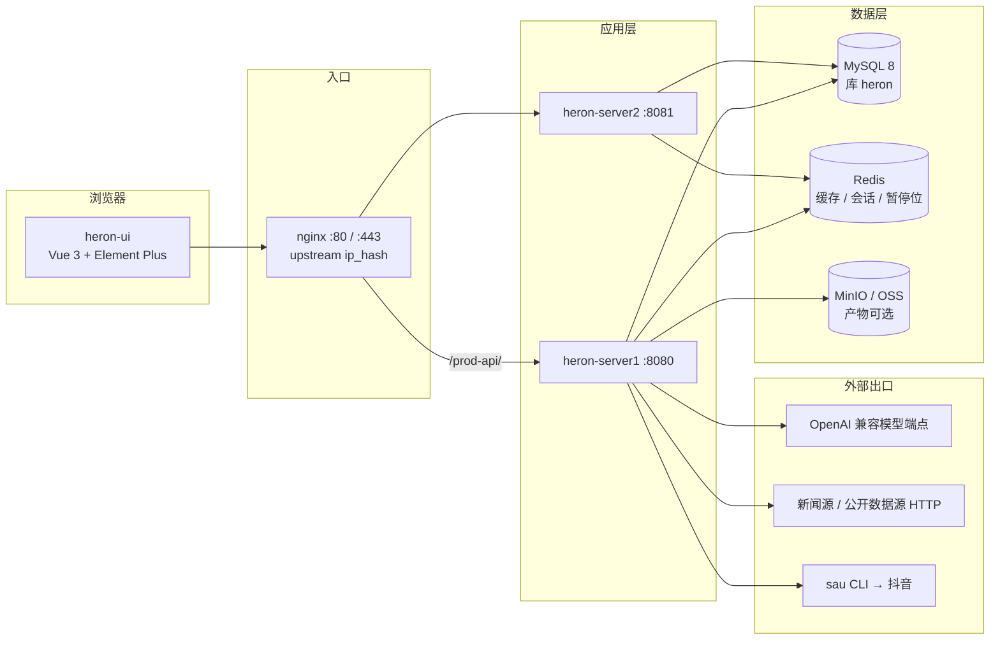
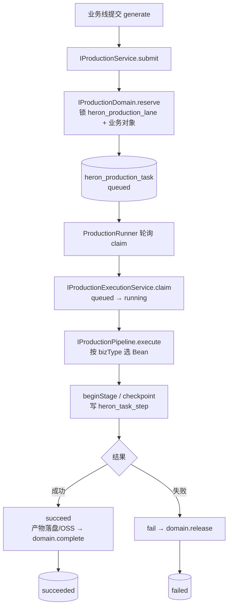
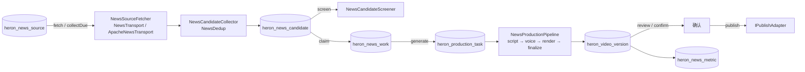
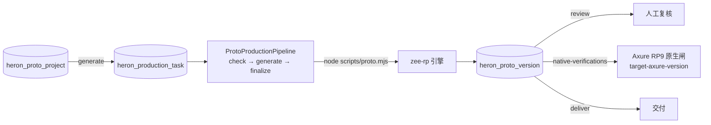

# CODE_WIKI — Heron

> 一句话：Heron 是「新闻视频 + Axure 原型」两条生产线的单租户内容生产系统，后端是 RuoYi-Vue-Plus 6.0.0 的一个业务模块，前端是 plus-ui 的一个分支。
>
> 本文件回答**代码怎么组织、每块干什么、怎么跑起来、改哪里**。业务规则、角色权限细节、契约字段、阶段背景**不在这里重写**，见文末「文档索引」。
>
> 生成日期：2026-11-10。基于工作区当前文件；不随代码自动更新。
>
> 位置：`heron/CODE_WIKI.md`（后端仓库根目录）。内容覆盖 `heron/` 与同级 `../heron-ui/` 两个仓库，跨仓链接用 `../` 相对路径。

---

## 0. 怎么用这份文档

| 你想做的事 | 先看 |
| --- | --- |
| 第一次接手，想知道东西都在哪 | 第 1、2 节 |
| 改一个后端接口/加字段 | 第 4、10 节 |
| 搞懂新闻/原型两条线怎么跑 | 第 5 节 |
| 新增数据源、发布出口 | 第 5.4、5.5、10 节 |
| 本地把系统跑起来 | 第 9.1 节 |
| 部署到服务器 | 第 9.2、9.3 节 |
| 配置项在哪、有哪些开关 | 第 8 节 |
| 跑测试 | 第 11 节 |

---

## 1. 仓库地图

工作区 `D:\zhoupei\heron` **不是 Git 仓库**（本文件位于其中的 `heron/`），里面是两个彼此独立、各自提交的仓库：

```text
D:\zhoupei\heron\
├── heron\                 # 后端仓库（独立 Git）：RuoYi-Vue-Plus 6.0.0 + Heron 业务模块
│   ├── ruoyi-admin\       # 唯一启动入口，聚合所有模块
│   ├── ruoyi-api\         # 跨模块 API 接口（RemoteXxx）
│   ├── ruoyi-common\      # 25 个公共子模块（core/web/mybatis/redis/satoken/...）
│   ├── ruoyi-extend\      # 扩展服务：monitor-admin、snailjob-server、snailai-server
│   ├── ruoyi-modules\     # 业务模块：system/job/gen/demo/workflow/ai/heron
│   ├── script\            # sql / docker / bin 部署脚本
│   └── data\              # 运行时数据根（模板、字体、音频、工作区、样例）
├── heron-ui\              # 前端仓库（独立 Git）：plus-ui 分支
│   └── src\
│       ├── api\heron\     # Heron 接口封装
│       ├── views\heron\   # Heron 页面
│       └── ...            # 基座页面与框架代码
├── docs\design\           # UI 阶段性报告
├── axure\                 # Axure RP9 空白模板等原语
└── harness-foundry\       # AI 工具/技能仓库，与 Heron 产品无关
```

**命名约定**：产品名统一用 Heron；`ruoyi-*` 坐标、模块名、基座类名保持不变，不要为了「干净」去改。

---

## 2. 系统架构

### 2.1 运行时拓扑



要点：

- 应用本身**无状态**，任务状态全在 MySQL；Redis 承担缓存、Sa-Token 会话与「自动生产暂停位」。
- 两个 server 实例通过 nginx `ip_hash` 分流；同一业务线的生产任务靠 `heron_production_lane` 的**数据库行锁**串行，不依赖 Redis 分布式锁。
- 模型调用走 OpenAI 兼容 HTTP（`/chat/completions`），不绑定某一家 SDK。

### 2.2 一次请求怎么走

前端请求 → `nginx /prod-api/` → `heron-server` → `ruoyi-admin` 内嵌容器（`context-path=/`，端口 8080）→ Sa-Token 鉴权 → `org.dromara.heron.controller.*` → `service` 接口 → `service.impl` → MyBatis-Plus Mapper → MySQL。

前端路由**不是静态的**：登录后调 `/getRouters` 拿后端菜单树，再 `router.addRoute` 动态挂载（见 7.2）。

---

## 3. 后端模块职责

### 3.1 顶层模块

| 模块 | 职责 | 改不改 |
| --- | --- | --- |
| `ruoyi-admin` | 唯一启动入口，聚合全部模块；产物 `ruoyi-admin/target/heron.jar` | 配置改这里 |
| `ruoyi-api` | 跨模块接口与共享 DTO（`ConfigService`、`DeptService`、`OssService`、`UserDTO` 等） | 基座，只读 |
| `ruoyi-common` | 25 个公共子模块：core/web/mybatis/redis/satoken/security/log/excel/oss/ai/push/doc/job/mqtt/sms/mail/social/translation/sensitive/encrypt/json/elasticsearch/liteflow/mcp/bom | 基座，只读 |
| `ruoyi-extend` | 独立扩展服务：`ruoyi-monitor-admin`、`ruoyi-snailjob-server`、`ruoyi-snailai-server` | 基座，只读 |
| `ruoyi-modules/ruoyi-system` | 用户/角色/菜单/部门/字典/参数/公告/OSS 配置 | 基座，只读 |
| `ruoyi-modules/ruoyi-job` | SnailJob 定时任务接入 | 基座，只读 |
| `ruoyi-modules/ruoyi-gen` | 代码生成器 | 基座，只读 |
| `ruoyi-modules/ruoyi-demo` | 框架示例 | 基座，只读 |
| `ruoyi-modules/ruoyi-workflow` | Warm-Flow 工作流 | 基座，按需 |
| `ruoyi-modules/ruoyi-ai` | 若依自带 AI 能力（SnailAI） | 基座，与本业务模型调用不是同一条路 |
| **`ruoyi-modules/ruoyi-heron`** | **全部 Heron 业务**，包名 `org.dromara.heron` | **你的主战场** |

**边界**：`ruoyi-common`、`ruoyi-api`、`ruoyi-system` 等基座模块默认只读。确需改动时按项目规范单独确认，不要把业务塞进公共模块。

### 3.2 ruoyi-heron 的依赖

```text
ruoyi-heron
├── ruoyi-common-core
├── ruoyi-common-web
├── ruoyi-common-mybatis
├── ruoyi-common-log
├── ruoyi-common-push        # SSE 消息推送
├── ruoyi-common-ai          # AI 基础设施
├── ruoyi-common-oss         # 产物落对象存储
├── ruoyi-api
├── httpclient5              # 外部 HTTP（新闻源、模型、数据源）
└── mysql-connector-j        # test scope
```

`ruoyi-admin` 依赖 `ruoyi-heron` 后随应用一起启动；**没有独立启动类**。

---

## 4. ruoyi-heron 内部分层

### 4.1 包结构

```text
org.dromara.heron
├── config\        HeronNewsConfiguration / HeronNewsProperties
│                  HeronProductionConfiguration / HeronProductionProperties
├── controller\    9 个 Controller + HeronExceptionHandler
├── domain\        实体（HeronXxx）、枚举（ProductionBizType/ProductionStatus/HeronAutoSlot…）
│   ├── bo\        入参对象
│   └── vo\        出参对象
├── mapper\        14 个 MyBatis-Plus Mapper（纯注解/接口，无 XML）
└── service\       16 个接口 + 扩展点
    └── impl\      64 个实现（含流水线、适配器、外部进程封装）
```

规模参考：`178` 个主代码 Java 文件（另有 `56` 个测试类）、`9` 个 Controller（含 1 个全局异常处理器）、`16` 个接口、`64` 个 `service/impl` 实现。没有 `resources/mapper/*.xml`，查询靠 MyBatis-Plus Lambda 与 Mapper 接口。

### 4.2 分层规则

- Controller 只做参数校验、权限注解、调用 service 接口；不写业务分支。
- `service` 放接口与扩展点，`service.impl` 放实现；跨业务的编排类也放在 impl 下（如 `NewsAutoService`）。
- 实体与表一一对应，表名统一 `heron_*`；基座字段（`create_by/create_time/update_by/update_time`）继承 `BaseEntity`。
- 权限统一走 `HeronAccessService`（`requireActor/requireObject/requirePermission/requireAnyPermission`）与 `@SaCheckPermission`。

### 4.3 Controller 一览

| Controller | 路由前缀 | 主要动作 |
| --- | --- | --- |
| `HeronAutoController` | `/heron/auto` | `status` / `run` / `pause` / `resume` |
| `HeronHealthController` | `/heron/health` | `overview` 今日候选/任务/失败/用量 |
| `NewsSourceController` | `/heron/newsSource` | `list` / `{id}` / 新增 / `{id}/fetch` |
| `NewsCandidateController` | `/heron/newsCandidate` | `list` / `{id}` / `manual` / `{id}/claim` |
| `NewsWorkController` | `/heron/newsWork` | `list` / `{id}` / `{id}/generate` / `versions` / `review` / `confirm` / `publish` / `publish-url` / `preview` / `download` |
| `NewsMetricController` | `/heron/metrics` | 保存/查询某版本指标 |
| `ProductionController` | `/heron/production` | `list` / `capabilities` / `{taskId}` / `cancel` / `evidence` |
| `ProtoController` | `/heron/proto` | 项目 CRUD / `archive` / `generate` / `versions` / `review` / `native-verifications` / `deliver` / 下载 |
| `HeronExceptionHandler` | — | 把 `HeronBusinessException` 映射为带 code 的 JSON |

---

## 5. 关键类与主链路

先记住一个底层事实：**新闻线和原型线共用同一套「生产执行底座」**，只是插入不同的 domain 与 pipeline。

### 5.0 统一生产执行底座



| 组件 | 类 | 说明 |
| --- | --- | --- |
| 业务类型 | `ProductionBizType` | 只有 `news_video`、`prototype`，不接受任意字符串 |
| 容量锁 | `HeronProductionLane` + `HeronProductionLaneMapper.lockByType` | 每条线一行，行锁即并发闸 |
| 提交与查询 | `IProductionService` / `ProductionServiceImpl` | 按 `bizType` 取 domain Bean；任务不存在或线未初始化直接报错 |
| 执行状态机 | `IProductionExecutionService` / `ProductionExecutionServiceImpl` | `claim/heartbeat/beginStage/checkpoint/succeed/fail/finishCancellation/requeueRecovered`；状态 `queued→running→succeeded/failed/cancelled`（`cancelling` 为过渡态） |
| 后台执行器 | `ProductionRunner` | 调度线程 + `heron-production-worker` 线程；按 `bizType` 选 pipeline Bean；受 `heron.production.worker-enabled` 控制 |
| 外部进程 | `ProductionProcessService` | 统一跑 `node/python/ffmpeg/ffprobe` 子进程，注入运行身份 |
| 产物 | `ProductionArtifactService` | 工作区/产物落盘、`finalizeFile`、可选 OSS |
| 能力探测 | `ProductionCapabilityService` | 检查工具是否就绪，前端 `capabilities` 接口的数据来源 |
| 恢复/清理 | `ProductionRecoveryService`、`ProductionCleanupService` | 重启后回收超时任务；清理只生成候选清单不自动删 |
| 通知/用量 | `ProductionNotificationService`、`ProductionUsageService` | SSE 通知；模型调用与 Token 记账 |
| 运行身份 | `ProductionRuntimeIdentityService` | 子进程运行身份 |

**Bean 名是硬约定**（改名字会导致 503 `production_capability_missing`）：

| 扩展点 | 接口 | 实现 | Bean 名 |
| --- | --- | --- | --- |
| 新闻领域 | `IProductionDomain` + `IProductionObjectScope` | `NewsProductionDomain` | `newsProductionDomain` |
| 原型领域 | `IProductionDomain` + `IProductionObjectScope` | `ProtoProductionDomain` | `prototypeProductionDomain` |
| 新闻流水线 | `IProductionPipeline` | `NewsProductionPipeline` | `newsProductionPipeline` |
| 原型流水线 | `IProductionPipeline` | `ProtoProductionPipeline` | `prototypeProductionPipeline` |

两个 pipeline Bean 都由 `HeronProductionConfiguration` 按开关条件注册：

- `heron.news.pipeline-enabled=true` → `newsProductionPipeline`
- `heron.prototype.engine-enabled=true` → `prototypeProductionPipeline`
- `heron.production.worker-enabled=true` → 执行线程启动

开关没开，接口不会 404，而是提交/执行时返回「生产线不可用」。**先查开关，再查代码**。

### 5.1 新闻线



| 环节 | 关键类 |
| --- | --- |
| 来源维护 | `NewsSourceServiceImpl`、`NewsSourceFetcher`、`NewsTransport` / `ApacheNewsTransport` |
| 定时采集 | `NewsSourceRunner`（受 `collection-enabled` 控制，`collectDue` 扫描到期来源） |
| 抓取安全 | `NewsUrlPolicy`、`NewsAddressPolicy`、配置白名单 `heron.news.allowed-hosts` |
| 候选入库 | `NewsCandidateCollector`、`NewsDedup`、`NewsFeedItem`、`NewsArticleBody` |
| 候选筛选 | `NewsCandidateScreener` |
| 稿件与版本 | `NewsWorkServiceImpl`、`NewsProductionDomain`、`NewsTemplatePicker` |
| 稿件生成 | `NewsScriptAuthor` → `NewsModelScriptAuthor`（唯一实现）、`NewsScriptContract` 校验 |
| 渲染流水线 | `NewsProductionPipeline`（阶段：`script` 5% → `voice` 25% → `render` 45% → `finalize` 85%） |
| 模型调用 | `OpenAiModelClient`（配置见 8.2；失败先记账再抛） |
| 发布 | `IPublishAdapter`（见 5.5）、`HeronNewsProperties.publishAdapter` |
| 指标 | `INewsMetricService` / `NewsMetricServiceImpl` |

`NewsWorkServiceImpl` 是新闻线的**聚合点**，注入：4 个 Mapper、`HeronAccessService`、`IProductionService`、`NewsProductionDomain`、`ProductionArtifactService`、`IPublishAdapter`、`NewsTemplatePicker`。改新闻流程先看它。

### 5.2 原型线



| 环节 | 关键类 |
| --- | --- |
| 项目管理 | `IProtoProjectService` / `ProtoProjectServiceImpl`（查询、创建、归档） |
| 需求稿生成 | `ProtoRp1Author` → `ProtoModelRp1Author`（唯一实现） |
| 领域与版本 | `ProtoProductionDomain`、`HeronProtoProject`、`HeronProtoVersion` |
| 流水线 | `ProtoProductionPipeline`（阶段：`check` 35% → `generate` 55% → `finalize` 85%） |
| 外部引擎 | `ProductionProcessService` 调 `node <zee-rp>/scripts/proto.mjs` |
| 原生校验 | `heron.prototype.target-axure-version`（当前只支持 RP9）+ `prototype-template` 空白模板 |

### 5.3 自动调度

| 组件 | 类 | 说明 |
| --- | --- | --- |
| 入口 | `HeronAutoController` | `status/run/pause/resume`，暂停位在 Redis |
| 调度器 | `NewsAutoRunner` | 按 `heron.news.auto-slots` 的 cron 列表触发；`auto-enabled` 才装配 |
| 业务编排 | `NewsAutoService` | 选源 → 筛候选 → 建 work → 调 `NewsWorkServiceImpl.generate` → 可选自动确认 |
| 暂停位 | `AutoPauseStore` / `RedisAutoPauseStore` | Redis 持久化，重启不丢 |
| 日槽 | `HeronAutoSlot`、`HeronAutoSlotMapper` | 每天最多几条由 slots 数量决定 |

`auto-slots` 为空 = 不自动产出；`auto-confirm-enabled` 控制生成后是否自动确认；`auto-actor-id` 是自动动作的操作人。

### 5.4 数据看板（dataset）

新闻流水线里 `kind=data_board` 的输入走数据集分支，**不是独立业务线**。

| 组件 | 类 | 说明 |
| --- | --- | --- |
| 选源 | `DatasetRouter` | 根据输入语意向模型要 `source_key`，并写 `heron_dataset_usage` |
| 取数 | `DatasetFetchService` | 构造器里手工注册全部适配器，`sourceKey → adapter` 建不可变 Map |
| 适配器接口 | `DatasetAdapter` | 方法 `sourceKey()` + 取数；新增源必须唯一 `sourceKey` |
| 契约 | `DatasetContract`、`DatasetScriptContract` | 行数、时间范围、单位、占位符校验 |
| 脚本生成 | `DatasetScriptAuthor` | 把数据集转成渲染脚本 |
| 一致性 | `DatasetSnapshot`、`DatasetFacts`、`DatasetPlaceholders`、`DatasetHttp` | 快照/事实/占位符重算，闸门在 `NewsProductionPipeline` 的 `data` gate |
| 注册表 | `heron_data_source` | `source_key / category / endpoint / enabled` |
| 用量 | `heron_dataset_usage` | 哪个版本用了哪个源 |

已注册适配器（15 个类，部分类承载多个 sourceKey）：`SinaFuturesDatasetAdapter`（黄金/原油）、`EastmoneyIndexAdapter`、`EastmoneyCpiAdapter`、`FrankfurterAdapter`、`MetNoAdapter`、`UsgsEarthquakeAdapter`、`WikimediaTopAdapter`、`HackerNewsAdapter`、`GithubTrendingAdapter`、`HuggingFaceAdapter`、`JikanTopAdapter`、`CheapSharkAdapter`、`WorldBankRankingAdapter`、`StackExchangeAdapter`、`DevToAdapter`。

### 5.5 发布出口

| 实现 | 触发条件 | 行为 |
| --- | --- | --- |
| `SandboxPublishAdapter` | `heron.news.publish-adapter` 缺省或 `sandbox` | 回执 URL 用 `sandbox://` 前缀，明确表示「未上抖音」 |
| `DouyinCliPublishAdapter` | `heron.news.publish-adapter=douyin-cli` | 调 `sau` 命令（浏览器自动化），不碰开放平台凭据；**命令不回传作品链接**，`workUrl` 留空，界面显示「已提交，待补链接」 |

两个实现互斥注册（`@ConditionalOnProperty`），任何时刻容器里只有一个 `IPublishAdapter`。

---

## 6. 依赖关系

### 6.1 后端模块依赖

```text
ruoyi-admin
├── ruoyi-heron ──┬── ruoyi-common-core/web/mybatis/log/push/ai/oss
│                 ├── ruoyi-api
│                 └── httpclient5
├── ruoyi-system
├── ruoyi-job
├── ruoyi-ai
├── ruoyi-workflow
├── ruoyi-gen
├── ruoyi-demo
├── ruoyi-common-doc / social / mail / mcp
└── spring-boot-admin-starter-client
```

### 6.2 运行时外部依赖

| 依赖 | 用途 | 缺了会怎样 |
| --- | --- | --- |
| MySQL 8 | 主库 `heron`，全部业务表 | 起不来 |
| Redis | Sa-Token、缓存、锁、自动生产暂停位 | 起不来 |
| 模型端点（OpenAI 兼容） | 写稿/选源/脚本生成 | 新闻与原型生产返回 `model_not_configured`/`model_failed` |
| 新闻源 / 数据源 HTTP | 采集与数据集 | 对应来源拉空或报错 |
| MinIO / OSS | 定稿产物外存 | 可留空，走本地产物盘 |
| `sau` CLI | 真实抖音发布 | 仅 `douyin-cli` 出口需要 |
| `zee-rp` + Node | 原型引擎 | 原型线报 `tool_missing` |
| `ffmpeg/ffprobe`、`python` | 渲染与监护 | 新闻渲染阶段失败 |
| `hyperframes` | 新闻 composition 渲染 | 能力检查报 `tool_missing:hyperframes` |

### 6.3 前端 → 后端契约

- 所有 Heron 接口在 `src/api/heron/<域>/index.ts` 封装，类型在 `types.ts`。
- 请求基址 `VITE_APP_BASE_API`（dev `/dev-api`，prod `/prod-api`），由 Vite 代理或 nginx 转发到后端。
- 鉴权头 `Authorization`（Sa-Token）；SSE 推送额外带 `clientid`（`src/utils/push.ts`）。
- 前端不做字段二次映射，**后端 VO 字段名即前端类型字段名**。

---

## 7. 前端 heron-ui

### 7.1 结构

```text
heron-ui/src
├── api\heron\
│   ├── auto\          auto/index.ts
│   ├── health\        health/index.ts + types.ts
│   ├── metrics\       metrics/index.ts
│   ├── newsCandidate\ index.ts + types.ts
│   ├── newsSource\    index.ts + types.ts
│   ├── newsWork\      index.ts + types.ts
│   ├── production\    index.ts + types.ts
│   └── proto\         index.ts + types.ts
├── views\heron\
│   ├── news\source\    来源管理
│   ├── news\candidate\ 候选池
│   ├── news\work\      稿件/版本/审片/发布（最重的页面）
│   ├── production\     生产任务列表与证据
│   └── proto\          原型项目、版本、复核、交付
├── router\            仅静态基础路由
├── store\modules\permission.ts   动态路由生成
├── permission.ts      路由守卫
└── utils\request.ts   axios 实例
```

技术栈：Vue 3 + TypeScript + Element Plus + Vite + Pinia + vue-router + UnoCSS；格式化/检查用 `oxfmt` / `oxlint`。

### 7.2 路由是动态的

`src/router` 里**没有** `views/heron` 的静态路由。流程：

1. 登录 → `permission.ts` 守卫 → `store/modules/permission.ts#generateRoutes`
2. 调 `getRouters()`（`src/api/menu`）取后端菜单树
3. 逐个 `router.addRoute`
4. 菜单本身来自 SQL 种子 `script/sql/heron/004-menu.sql` 的保留段 `1761400000000002000-1761400000000002999`

**新增页面除了写 `.vue`，还要写菜单 SQL**，否则页存在但进不去。

### 7.3 页面 → API → 后端

| 页面 | 使用的 API | 后端 Controller |
| --- | --- | --- |
| `views/heron/news/source` | `api/heron/newsSource` | `NewsSourceController` |
| `views/heron/news/candidate` | `api/heron/newsCandidate` | `NewsCandidateController` |
| `views/heron/news/work` | `api/heron/newsWork` + `production` + `metrics` | `NewsWorkController` + `ProductionController` + `NewsMetricController` |
| `views/heron/production` | `api/heron/production` | `ProductionController` |
| `views/heron/proto` | `api/heron/proto` + `production` | `ProtoController` + `ProductionController` |
| （无独立页面） | `api/heron/auto`、`api/heron/health` | `HeronAutoController`、`HeronHealthController` |

---

## 8. 配置项与环境变量

### 8.1 配置加载顺序

1. `ruoyi-admin/src/main/resources/application.yml` + `application-{dev|prod}.yml`
2. `spring.config.import: optional:file:./.env[.properties]` —— **启动工作目录**下的 `.env`
3. `ruoyi-heron/src/main/resources/heron-production.yml`（`@PropertySource` 加载，作为 heron.* 默认值）
4. 数据库 `sys_config`（模型三键最高优先级，见 8.3）

profile 由 Maven 过滤 `@profiles.active@` 决定。

### 8.2 Heron 业务配置（`heron-production.yml`）

| 键 | 默认 | 作用 |
| --- | --- | --- |
| `heron.production.data-root` | `./data` | 任务工作区与产物根目录，相对应用工作目录 |
| `heron.production.news-max-bytes` | `209715200` | 新闻任务产物上限（200 MB） |
| `heron.production.prototype-max-bytes` | `52428800` | 原型任务产物上限（50 MB） |
| `heron.production.worker-enabled` | `false` | **生产执行线程总开关** |
| `heron.production.cleanup-retention-days` | `7` | 清理候选的保留天数（不自动删） |
| `heron.production.python/node/ffmpeg/ffprobe` | `python3/node/ffmpeg/ffprobe` | 外部命令 |
| `heron.production.zee-rp` | `zee-rp` | 原型引擎根目录（内含 `scripts/proto.mjs`） |
| `heron.production.hyperframes` | `null` | 新闻渲染入口 `.mjs` |
| `heron.production.guard-enabled` | `true` | 监护脚本，仅 Linux 生效；Windows 开发机必须设 `false` |
| `heron.production.news-template` | `./data/templates` | 新闻 composition 模板根（每套带 `LOCK.json`） |
| `heron.production.prototype-template` | `null` | Axure RP9 空白模板，缺了原型线报不可用 |
| `heron.production.oss-config-key` | `null` | 指向 `sys_oss_config.config_key`；空 = 本地产物盘 |
| `heron.prototype.target-axure-version` | `Axure RP 9` | 原生闸比对基准 |
| `heron.prototype.engine-enabled` | `false` | **原型流水线装配开关** |
| `heron.prototype.engine-assets` | 无 | 引擎能力声明（引擎提交号 + 支持的 widget 名单），启动时与引擎实际 HEAD/模板哈希比对 |
| `heron.news.allowed-hosts` | `[]` | 采集白名单，空 = 不开放任何网络来源 |
| `heron.news.collection-enabled` | `false` | **定时采集开关**（装配 `NewsSourceRunner`） |
| `heron.news.pipeline-enabled` | `false` | **新闻流水线装配开关** |
| `heron.news.auto-enabled` | `false` | **自动调度装配开关** |
| `heron.news.auto-slots` | `[]` | cron 列表，几条 = 每天最多几条 |
| `heron.news.auto-confirm-enabled` | `true` | 自动生成后是否自动确认 |
| `heron.news.auto-actor-id` | `1` | 自动动作的操作人 |
| `heron.news.publish-adapter` | 缺省 = `sandbox` | `sandbox` 或 `douyin-cli` |
| `heron.news.publish-command` | 无 | `douyin-cli` 时 `sau` 可执行文件路径 |
| `heron.news.publish-account` | 无 | `douyin-cli` 使用的账号名（cookie 存本地） |
| `heron.news.publish-timeout-seconds` | 无 | 发布命令超时 |

`application-dev.yml` 当前对本机做了覆盖（**绝对路径，换机器要改**）：

```yaml
heron:
  production:
    python: python
    guard-enabled: false
    node: D:/Users/zhoupei/AppData/Local/nvm/v24.22.1/node.exe
    hyperframes: D:/zhoupei/heron/heron/data/tools/node_modules/hyperframes/bin/hyperframes.mjs
    news-template: D:/zhoupei/heron/heron/data/templates
    zee-rp: D:/zhoupei/tmp/zee-rp-v0.2.1
    prototype-template: D:/zhoupei/heron/axure/blank-rp9.rp
    worker-enabled: true          # 与 heron-production.yml 默认值相反
    oss-config-key: qiniu
  prototype:
    engine-enabled: true          # 同上
    engine-assets: '{"engineCommit":"...","supportedWidgets":[...]}'
  news:
    pipeline-enabled: true
    collection-enabled: true
    allowed-hosts: [www.ithome.com, sspai.com, www.ifanr.com, www.tmtpost.com, m.tmtpost.com, www.199it.com]
    auto-enabled: false
    auto-slots: ["0 0 11 * * ?", "0 0 15 * * ?", "0 0 19 * * ?"]
    publish-adapter: douyin-cli
    publish-command: D:/zhoupei/heron/heron/data/tools/social-auto-upload/.venv/Scripts/sau.exe
    publish-account: heron
    publish-timeout-seconds: 240
```

**注意**：本地 dev 把生产 worker 和两条流水线都打开了，而 `heron-production.yml` 默认全关。排查「生产环境为什么不动」时别拿本机行为当基准。

（`application-prod.yml` 没有 heron 覆盖，全部走 `heron-production.yml` 默认值 + 部署侧环境变量。）

### 8.3 模型配置（三键）

`OpenAiModelClient` 读取顺序：`sys_config` → Spring Environment。

| `sys_config` 键 | 环境变量回退 |
| --- | --- |
| `heron.model.base-url` | `HERON_MODEL_BASE_URL` |
| `heron.model.name` | `HERON_MODEL_NAME` |
| `heron.model.api-key` | `HERON_MODEL_API_KEY` |

- `base-url` **不含** `/chat/completions`，代码自己拼。
- 三键任一为空 → `503 model_not_configured`。
- `005-model-config.sql` 只插入空值占位，真实密钥由部署侧在「参数管理」里填，不进 Git。

### 8.4 数据库与中间件

| 项 | dev | prod |
| --- | --- | --- |
| MySQL | `localhost:3307/heron`（`docker-compose.dev-isolated.yml`） | `localhost:3306/heron` |
| Redis | `localhost:6380` | `localhost:6379` |
| 应用端口 | `8080` | `8080`（compose 里 server2 用 8081） |
| context-path | `/` | `/` |

口令现状（**不一致，改密时注意**）：

- 数据源的 `password` 在 `application-dev.yml` / `application-prod.yml` 里是**明文**写死的开发口令，改密要同时改两个 profile。
- Redis 的 `password` 两个 profile 都引用 `${HERON_PASSWORD}`，来自启动目录 `.env` 或环境变量。
- `.env` 里另有 `REDIS_PASSWORD` 一项；后端 Redis 配置目前不引用它，别把它当成生效配置。

部署侧文档要求：主应用与扩展应用的数据源、Redis 统一使用 `HERON_PASSWORD`（见 `heron/README.md`）。实际 yml 尚未全部收敛到这一点。

### 8.5 前端环境变量

| 变量 | dev | prod | 作用 |
| --- | --- | --- | --- |
| `VITE_APP_BASE_API` | `/dev-api` | `/prod-api` | 请求基址 |
| `VITE_APP_PROXY_TARGET` | 默认 `http://localhost:8080` | — | dev 代理目标；当前 `.env.development.local` 设为 `http://localhost:18081` |
| `VITE_APP_CONTEXT_PATH` | `/` | `/` | 部署子路径 |
| `VITE_APP_ENCRYPT` | `true` | `true` | 请求加密开关（RSA 密钥在 `.env.*`，勿外传） |
| `VITE_APP_MESSAGE_*` | SSE | SSE | 消息推送 |
| `VITE_APP_MONITOR_ADMIN` / `SNAILJOB_ADMIN` / `SNAILAI_ADMIN` | 本地地址 | 相对路径 | 外链入口 |

---

## 9. 运行与部署

> 以下命令按仓库内 `README.md`、`pom.xml`、`package.json`、compose 文件转写，**本次未实测**。标注「仓库原文」的为文档原话。

### 9.1 本地开发

前置：JDK 21（README 标注支持 21/25）、Maven 3.9+（或 `./mvnw`）、Node 22+、pnpm、Docker（可选）。

以下后端命令在 **`heron/` 仓库根目录**执行；前端命令在 `../heron-ui/`。

**① 起依赖**（本机隔离栈，端口 3307/6380，容器名 `heron-dev-mysql` / `heron-dev-redis`）：

```bash
docker compose -f script/docker/docker-compose.dev-isolated.yml up -d
```

口令写在 compose 文件里，直接用；不要把它复制到别处。

**② 建库**

仓库原文：先创建空库 `heron`，再导入 `script/sql/ry_vue.sql`；按需导入工作流脚本。

**③ 起后端**

```bash
./mvnw -pl ruoyi-admin -am package
java -jar ruoyi-admin/target/heron.jar
```

启动工作目录下需要 `.env`（至少 `HERON_PASSWORD`），否则数据源与 Redis 连不上。

**④ 起前端**

```bash
cd ../heron-ui
pnpm install
pnpm dev
```

Vite 把 `/dev-api` 代理到 `VITE_APP_PROXY_TARGET`（默认 8080）。

### 9.2 容器部署

```bash
# 1) 构建产物
./mvnw -pl ruoyi-admin -am package

# 2) 构建镜像（标签是本地约定，不是已发布地址）
docker build -t heron-server:6.0.0 ruoyi-admin

# 3) 起全栈（在本仓库根目录执行）
docker compose --env-file .env -f script/docker/docker-compose.yml up -d
```

compose 拓扑：

| 服务 | 镜像 | 端口 |
| --- | --- | --- |
| `mysql` | `mysql:8.4.9` | `3306` |
| `redis` | `redis:8.6.3` | `6379` |
| `nginx-web` | `nginx:1.31.1` | `80` / `443` |
| `minio` | `pgsty/minio` | `9000` / `9001` |
| `heron-server1` | `heron-server:6.0.0` | host 网络，`SERVER_PORT=8080` |
| `heron-server2` | `heron-server:6.0.0` | host 网络，`SERVER_PORT=8081` |
| `ruoyi-monitor-admin` | `ruoyi/ruoyi-monitor-admin:6.0.0` | `9090` |
| `ruoyi-snailjob-server` | `ruoyi/ruoyi-snailjob-server:6.0.0` | `8800` / `17888` |
| `ruoyi-snailai-server` | `ruoyi/ruoyi-snailai-server:6.0.0` | `8900` / `18888` |

nginx 配置：`upstream server { ip_hash; 127.0.0.1:8080; 127.0.0.1:8081; }`；`/prod-api/ → server/`，`/admin/ → monitor-admin`，`/snail-job/`、`/snail-ai/` 分别反代。

Redis 私密配置：`script/docker/redis/conf/redis-local.conf` 写 `requirepass`，与 `HERON_PASSWORD` 一致；缺文件 Redis 拒绝启动。

### 9.3 数据库脚本

| 脚本 | 用途 | 注意 |
| --- | --- | --- |
| `script/sql/ry_vue.sql` | 若依基座建表与初始数据 | 导入空库 `heron` |
| `script/sql/ry_workflow.sql` | 工作流 | 按需 |
| `script/sql/ry_ai.sql`、`ry_job.sql` | AI / 定时任务 | 按需 |
| `script/sql/heron/001~015-*.sql` | Heron 业务表、菜单种子、模型配置占位、数据源注册 | **文件头明写「幂等迁移由 E2 在授权环境执行，本文件不在现有 heron 库直接运行」**；不要在现有库直接跑 |
| `script/sql/update/` | 基座版本升级 | 按版本顺序 |

Heron 业务表（14 张）：

```text
heron_production_lane   heron_production_task   heron_task_step
heron_usage_record      heron_news_source       heron_news_candidate
heron_news_work         heron_video_version     heron_proto_project
heron_proto_version     heron_auto_slot         heron_news_metric
heron_data_source       heron_dataset_usage
```

### 9.4 裸机启停

```bash
./script/bin/ry.sh start|stop|restart|status
```

脚本约定 `AppName=heron.jar`，JVM 参数含 `-Xms512m -Xmx1024m`、ZGC、`HeapDumpOnOutOfMemoryError`；日志 `logs/heron.jar.log`。

---

## 10. 常见改动路径

| 改动 | 必动文件 | 容易漏的地方 |
| --- | --- | --- |
| 给业务表加字段 | `domain/HeronXxx.java`、`domain/bo`、`domain/vo`、`script/sql/heron/` 新迁移 | 前端 `api/heron/*/types.ts`；Mapper 若用 Lambda 不用改 |
| 新增一个后端接口 | `controller/XxxController.java`、`service/IXxxService.java`、`service/impl/XxxServiceImpl.java` | `@SaCheckPermission` 权限串；菜单 SQL 里的按钮权限 |
| 新增新闻来源 | 无需写代码：`heron_news_source` 数据 + `heron.news.allowed-hosts` 加主机名 | `collection-enabled=true` 才会装配定时采集 |
| 新增数据源适配器 | 实现 `DatasetAdapter`（唯一 `sourceKey`）；在 `DatasetFetchService` 构造器注册；`008/010~015-data-source*.sql` 加注册行 | `sourceKey` 重复会在启动时 `toUnmodifiableMap` 直接抛异常 |
| 新增发布出口 | 实现 `IPublishAdapter`，加 `@ConditionalOnProperty(prefix="heron.news", name="publish-adapter", havingValue="<新值>")` | 配置里同时只能命中一个实现 |
| 新增业务线 | `ProductionBizType` 加枚举、`heron_production_lane` 加行、写 `IProductionDomain` + `IProductionPipeline` 实现并在 `HeronProductionConfiguration` 注册 Bean | Bean 名硬约定；`ProductionRunner.pipeline()`、`ProductionServiceImpl.domain()`、`ProductionExecutionServiceImpl.domain()` 三处选择逻辑也要加分支 |
| 新增前端页面 | `views/heron/<页面>/index.vue`、`api/heron/<域>/index.ts` + `types.ts`、菜单 SQL | 不写菜单 SQL 页面进不去（动态路由） |
| 调整流水线阶段 | 对应 `*ProductionPipeline` 的 `beginStage` 调用与百分比 | 阶段名会进 `heron_task_step`，前端进度依赖它 |
| 打开某条线 | `heron-production.yml` 或部署侧环境变量里的 `*-enabled` 开关 | 开关是 Bean 装配条件，改了要重启，不是热生效 |
| 换模型 | `sys_config` 三键（优先）或 `HERON_MODEL_*` 环境变量 | `base-url` 不含 `/chat/completions` |

---

## 11. 测试与验证

### 11.1 后端

- 位置：`ruoyi-modules/ruoyi-heron/src/test/java`，共 56 个测试类；夹具在 `src/test/resources/news-feeds`（RSS/Atom/XXE）与 `process-fixtures`。
- 默认排除组由 `pom.xml` 控制：`heron.test.excludedGroups = exclude,mysql,render`。即默认**不跑**标了 `@Tag("exclude")`、`mysql`、`render` 的用例（需要真库或渲染环境）。

```bash
# 默认（跳过 exclude/mysql/render）
./mvnw -pl ruoyi-modules/ruoyi-heron test

# 全量（含 render/mysql，需对应环境；未实测）
./mvnw -pl ruoyi-modules/ruoyi-heron test -Dheron.test.excludedGroups=
```

测试覆盖重点：流水线阶段与闸门（`NewsProductionPipelineTest`、`NewsProductionPipelineRenderTest`）、数据集契约与适配器（`Dataset*Test`）、发布出口（`DouyinCliPublishAdapterTest`）、模型客户端（`ModelClientTest`）、菜单与表结构（`HeronMenuSeedTest`、`ProductionSchemaTest`）。

### 11.2 前端

```bash
cd heron-ui
pnpm lint                                        # oxlint src
pnpm fmt                                         # oxfmt .
pnpm exec vitest run --config vitest.heron.config.ts
pnpm build                                       # vite build --mode production
```

`vitest.heron.config.ts` 只收集 `src/**/heron/**/*.test.ts`（当前有 `views/heron/production/task-state.test.ts`）。`package.json` 里没有 `test` 脚本，必须显式带 `--config`。

### 11.3 验收提醒

- 后端单测通过 ≠ 功能可用：流水线依赖外部命令（Node/ffmpeg/zee-rp/Axure 模板），这些在 CI 里通常没有。
- 前端改动要在浏览器里实际走一遍：登录 → 菜单 → 页面；只跑 lint/build 不能证明交互正确。

---

## 12. 文档索引

| 文档 | 内容 |
| --- | --- |
| [业务规格](docs/plans/2026-10-29-heron-business-spec.md) | 角色、业务流程、验收口径（**业务规则的唯一来源**） |
| [双线需求](docs/plans/2026-11-02-heron-two-line-requirements.md) | 新闻线 + 原型线需求 |
| [实现设计](docs/plans/2026-11-03-heron-implementation-design.md) | 生产底座、状态机、并发与恢复设计 |
| [Dataset 契约](docs/plans/2026-11-10-dataset-contract.md) | 数据看板契约与产物格式 |
| [后端仓库指令](AGENTS.md) / [CLAUDE.md](CLAUDE.md) | 后端编码规范与验证要求 |
| [前端仓库指令](../heron-ui/AGENTS.md) / [CLAUDE.md](../heron-ui/CLAUDE.md) | 前端规范与组件约定 |
| [产品定义](../heron-ui/PRODUCT.md) | 用户、角色、产品目的与边界 |
| [UI 第二阶段报告](../docs/design/2026-11-04-heron-ui-phase2-report.md) | 「静默工业」方向与改造结论 |
| 运行时契约 md | `ruoyi-modules/ruoyi-heron/src/main/resources/heron/*.md`（新闻/数据集/原型脚本契约、选材提示词、写作风格、dataset 路由） |

---

## 维护约定

- 只写**代码组织**；业务规则变化改 plans 里的文档，不在这里复述。
- 改动落点变了，同步更新第 10 节；开关/配置键变了，同步更新第 8 节。
- 本文夹带的本机绝对路径（8.2）换机器时必须改。
