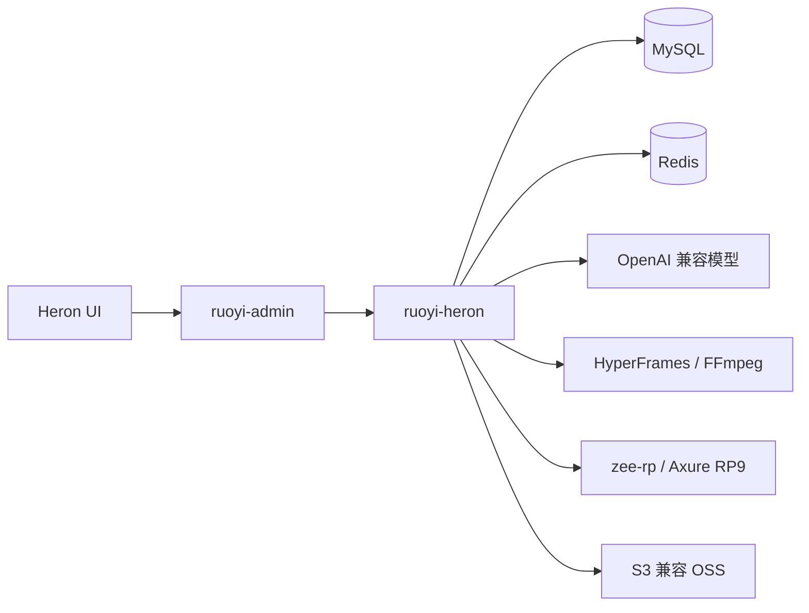

# Heron

> 单租户、自部署的内容生产与原型工作台。热榜进、成片出、人确认；需求进、可交付原型出。

Heron 基于 RuoYi-Vue-Plus 6.1.0 构建，保留若依的账号、角色、菜单、审计、存储和任务能力，把业务集中在 `ruoyi-modules/ruoyi-heron`。它不是一套后台 CRUD 模板，而是一条可追踪、可审核、可恢复的内容生产链路。

本文以仓库当前代码和配置为准。产品边界、业务规则和验收口径见 [业务规格](docs/plans/2026-10-29-heron-business-spec.md)。

## 业务地图

### 新闻视频生产线

从热点采集到发布回执，系统把每一步的状态、输入、产物和失败原因落到数据库。制作人可以认领候选、修改稿件、触发生成和重跑；审片人可以查看成片、联络表、分镜和质量报告，再决定确认或驳回。

| 子线 | `kind` | 模板前缀 | 画面主体 | 生产链路 |
| --- | --- | --- | --- | --- |
| 文稿解说线 | `article` | `news-*` | 文字排版 | 热点 → 写稿 → 核查 → 套版渲染 |
| 数据看板线 | `data_board` | `news-data-*` | 图表 | 热点 → 选源 → 数据集快照 → 写稿 → 出图渲染 |

两条子线共用 `ProductionBizType.news_video`，由版本冻结输入里的 `kind` 区分。自动槽位默认使用数据看板模板 `news-data-9x16`；模板不存在时直接失败，不静默回退到其他模板。

核心对象包括新闻来源、候选、作品、视频版本、生产任务、发布尝试、质量报告和表现指标。每次重渲都会产生新版本，旧版本不会被覆盖。

### 原型工坊

原型线把需求转成 RP/1 源码，再交给 `zee-rp` 做结构检查和原生 `.rp` 装配。流程是：

```text
需求 → RP/1 → check → compile → 预览与审计 → 人工审核 → Axure 原生验证 → 交付
```

每次生成保留独立版本，记录源码、引擎版本、模型用量、预览图、文件指纹和失败原因。系统不会伪造“已在 Axure 打开”的结论；未完成原生验证的版本会持续显示验证状态。

### 研究与决策支持

Heron 还包含一层辅助能力：

- AgentScope 研究任务与快照
- 内容决策、策略假设和成本记录
- 数据机会发现与数据集目录
- 抖音热点采集与参考素材治理
- 成片质量报告、表现反馈和创作建议

这些能力服务于生产决策，不等于外部平台数据已经自动接通。

## 生产原则

- **发布默认人确认。** 确认人、确认时间和联络表指纹绑定到同一视频版本；重渲后原确认失效。
- **自动模式显式开启。** 自动模式只关闭人工闸，其余闸照常执行，并要求源级开关、灰度准入、槽位幂等和止损手段。
- **失败必须可解释。** 错误至少回答哪条闸、哪段输入、为什么拒绝；不吞异常，不静默重试，不自动改写稿件。
- **产物可追溯。** 任务租约、版本、文件哈希、发布回执和用量记录互相引用，重启后可以恢复在途任务。
- **发布回执不伪装。** `sandbox://` 只证明链路跑通，不代表内容已发布到抖音。

## 技术栈

| 领域 | 当前实现 |
| --- | --- |
| 应用基座 | RuoYi-Vue-Plus 6.1.0 |
| 运行时 | JDK 21、Spring Boot 4.1.2、Jetty |
| 数据访问 | MyBatis-Plus 3.5.18、MySQL 8.x、Flyway |
| 认证与缓存 | Sa-Token 1.46.0、Redis、Redisson 4.8.0 |
| 研究与模型 | AgentScope 2.1.0-BETA1、OpenAI 兼容协议 |
| 新闻渲染 | Node.js 22+、HyperFrames、FFmpeg / FFprobe |
| 原型装配 | zee-rp v0.2.1、Axure RP9 空白工程 |
| 文件存储 | 本地产物盘或 S3 兼容 OSS，复用基座 `sys_oss_config` |

## 架构



`ruoyi-admin` 是唯一启动入口。业务模块按 `domain` / `domain.bo` / `domain.vo` / `mapper` / `service` / `service.impl` / `controller` 分层，复杂生产流程由 pipeline 和 domain service 编排。

```text
heron/
├── ruoyi-admin/                      # 启动入口、主配置、Flyway、Dockerfile
├── ruoyi-modules/ruoyi-heron/        # Heron 业务模块
│   ├── src/main/java/org/dromara/heron/
│   │   ├── controller/               # REST 接口与权限边界
│   │   ├── domain/                   # 实体、BO、VO、状态与契约
│   │   ├── mapper/                   # MyBatis-Plus 数据访问
│   │   ├── service/                  # 业务服务与生产流水线
│   │   ├── agentscope/               # 研究 Agent 运行时
│   │   └── config/                   # 业务配置与条件装配
│   └── src/main/resources/heron-production.yml
├── data/                             # 模板、字体、音效、知识包、渲染依赖清单
├── script/sql/                       # 基线与历史 SQL
├── script/docker/                    # 开发和生产编排参考
└── docs/plans/                       # 业务规格与设计记录
```

## 快速开始

### 环境要求

- JDK 21
- Maven 3.9+
- MySQL 8.x
- Redis 6+
- Node.js 22+、FFmpeg、FFprobe（新闻渲染需要）
- 原型线另需 zee-rp v0.2.1 和 Axure RP9 空白工程

### 1. 准备数据库与 Redis

仓库提供了本机隔离栈，使用独立容器名和端口，不占用宿主机上已有的 MySQL / Redis：

```bash
docker compose -f script/docker/dev/docker-compose.dev-isolated.yml up -d
```

隔离栈初始化的库名是 `heron`，当前 `application-dev.yml` 默认连接 `heron_dev`。下面显式创建并导入开发库，避免两边库名不一致：

```bash
mysql -h 127.0.0.1 -P 3307 -uroot -p \
  -e "CREATE DATABASE IF NOT EXISTS heron_dev CHARACTER SET utf8mb4 COLLATE utf8mb4_general_ci;"
mysql -h 127.0.0.1 -P 3307 -uroot -p heron_dev < script/sql/ry_vue.sql
```

如果使用自己的数据库，请同步修改数据源、库名和账号；已有数据不会因为修改初始化配置自动迁移或重建。

### 2. 配置本地环境

在仓库根目录创建 `.env`，该文件已被 Git 忽略。至少设置：

```dotenv
HERON_PASSWORD=<与本地 Redis 配置一致>
SA_TOKEN_JWT_SECRET=<本地随机签名密钥>
```

开发 profile 提供了仅供本机使用的 JWT 兜底值；生产 profile 没有兜底值，未提供 `SA_TOKEN_JWT_SECRET` 会拒绝启动。模型参数沿用基座 `sys_config` 中的 `heron.model.*`，不要把真实密钥写进 README、SQL 或提交记录。

### 3. 构建并启动

```bash
mvn -pl ruoyi-admin -am package
java -jar ruoyi-admin/target/heron.jar
```

默认开发端口为 `8085`。启动后接口文档通常位于 `http://localhost:8085/api-docs`，实际路径受安全配置控制。

新闻渲染依赖需要单独安装：

```bash
cd data/tools
npm ci
```

模板、字体、音效和 BGM 已随仓库提供；`node_modules` 不入库，由 `package-lock.json` 还原。

### 4. 启动前端

前端是独立仓库 [Heron UI](https://github.com/zhoupei6251/heron-ui)。开发代理默认把 `/dev-api` 转发到 `http://localhost:8085`，两边接口加密开关和 RSA 密钥必须配套。

## 配置入口

| 文件 | 用途 |
| --- | --- |
| `.env` | 本地私密环境变量，不提交 |
| `ruoyi-admin/src/main/resources/application.yml` | 端口、Sa-Token、Flyway、消息推送、接口文档等公共配置 |
| `application-dev.yml` | 本机开发数据源、Redis、渲染路径和发布适配器 |
| `application-prod.yml` | 生产数据源、Redis 和外部服务配置 |
| `ruoyi-modules/ruoyi-heron/src/main/resources/heron-production.yml` | 新闻、原型、采集、自动槽位和产物保留规则 |
| `sys_config` | 模型地址、模型名和密钥等运行参数 |

常用覆盖项：

| 环境变量 | 说明 |
| --- | --- |
| `HERON_PASSWORD` | Redis 与本地开发栈使用的口令；数据源配置以 `application-*.yml` 为准 |
| `SA_TOKEN_JWT_SECRET` | JWT 签名密钥；生产必填，多实例必须一致 |
| `HERON_NODE` | 固定 Node 可执行文件路径 |
| `HERON_HYPERFRAMES` | HyperFrames 入口路径 |
| `HERON_NEWS_TEMPLATE` | 新闻模板根目录 |
| `HERON_ZEE_RP` | zee-rp 引擎根目录 |
| `HERON_PUBLISH_COMMAND` | `douyin-cli` 发布命令路径 |

## 数据库迁移

- 基座库先导入 `script/sql/ry_vue.sql`。
- 业务迁移由 Flyway 在启动时执行，记录写入 `flyway_schema_history`。
- 当前基线版本为 `45`，`script/sql/heron/001~045` 只作历史查阅。
- 已应用的迁移不能修改；校验和不一致会直接拒绝启动。
- 新迁移写入 `ruoyi-admin/src/main/resources/db/migration/V{序号}__{描述}.sql`。

## 部署

生产镜像基于 `ruoyi-admin/Dockerfile`，工作目录为 `/heron/server`。构建命令：

```bash
mvn -Pprod -pl ruoyi-admin -am package
docker build -t heron:prod -t heron-server:6.1.0 ruoyi-admin
```

生产编排参考位于 `script/docker/prod/docker-compose.yml`，环境变量模板位于 `script/docker/prod/.env.example`。使用前必须核对：

- `application-prod.yml` 的数据源和 Redis 地址与 Compose 端口是否一致
- 两个 Heron 服务的镜像标签是否都已构建
- `/docker/mysql`、`/docker/redis`、`/docker/nginx`、`/docker/server1` 等宿主机挂载是否存在
- Nginx、证书、OSS 和模型凭据是否已配置
- 多实例是否使用同一个 `SA_TOKEN_JWT_SECRET` 和 Redis 数据库

准备完成后可从仓库根目录启动指定服务：

```bash
docker compose --env-file script/docker/prod/.env \
  -f script/docker/prod/docker-compose.yml up -d heron-server1 nginx-web
```

这是 Linux 主机上的参考编排，不是可直接套用的本地开发栈。修改 `MYSQL_DATABASE` 或初始化 SQL 不会重建已有数据目录；迁移前请先备份。

## 验证

业务模块默认执行单元测试，并排除需要外部环境的 `mysql`、`render` 标签：

```bash
mvn -pl ruoyi-modules/ruoyi-heron test
```

模板与渲染依赖检查：

```bash
cd data/tools
npm ci
npm run templates:check
```

需要运行 MySQL 集成测试或真实渲染测试时，先准备对应环境，再显式调整 Surefire 的 `heron.test.excludedGroups`。不要在全量构建中隐式连接生产数据库。

## 当前边界

- 产品是单租户自部署，不包含多租户、套餐、配额、计费、自助注册和第二套 RBAC。
- 新闻自动产出和自动确认默认关闭；开启前必须完成源级准入、发布出口和止损配置。
- 当前发布适配器为 `sandbox` 与 `douyin-cli`。抖音开放平台 `video.create` 尚未形成已装配的官方适配器。
- 原型线依赖外部 zee-rp 引擎和 Axure RP9 空白工程；商业模板和 `.rp` 文件不入库。
- 研究 Agent 受配置和模型凭据约束；Elasticsearch、MQTT、MCP 等可选能力默认未装配。
- 页面存在、接口存在、配置打开是三件事，不能互相推导为生产验收通过。

## 文档与许可

- [业务规格](docs/plans/2026-10-29-heron-business-spec.md)
- [项目开发约定](CLAUDE.md)
- [RuoYi-Vue-Plus 官方文档](https://plus-doc.dromara.org/)

Heron 沿用 MIT 开源许可。使用、修改或分发时请保留仓库中的许可文件与上游署名。
