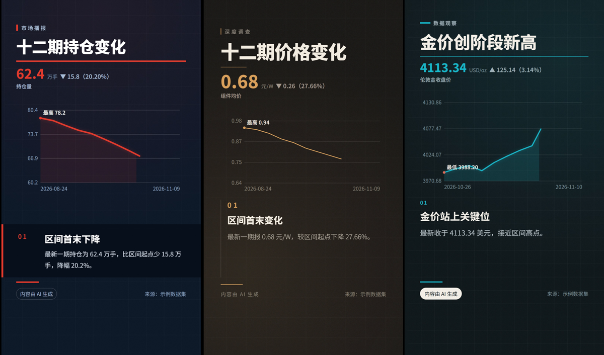

# 2026-11-20 成片响度整改与真实样片验收

> 范围：关闭 [P0 事实与音画核查](2026-11-19-p0-fact-audio-audit.md) 判为「不通过」的音频项（BGM 压旁白、无响度/峰值检测），
> 并按 [真实样片验收清单](2026-11-19-real-sample-acceptance-checklist.md) 跑三条真实样片。
> 环境：dev 库 `heron`（MySQL 3307 / Redis 6380），应用 `heron.jar` 起在 8086，Node 24.21.0（渲染前提）。
> 产物落 `docs/acceptance-2026-11-20/`（不进版本库），本报告进版本库。

---

## 0. 一句话结论

四条真实片子全部出片，成片响度全部落在 **−16 LUFS ±1、真峰值 ≤ −1.5 dBTP** 的交付口径内（独立 ebur128 复测一致）；
验收途中发现并修掉 **3 个真缺陷**，其中 1 个让整条自动产出线在 dev 上 100% 失败。

---

## 1. 音频：从「不通过」到实测达标

### 1.1 改了什么

| | 改前 | 改后 |
| --- | --- | --- |
| 配乐增益 | 固定 0.22（片尾 0.40），不看旁白实际多响 | 按实测旁白与配乐的响度反算 |
| 响度口径 | 无 | 成片 −16 LUFS ±1；真峰值 ≤ −1.5 dBTP；配乐比成片低 12 dB |
| 峰值保护 | `amix normalize=0` 直接叠加，越界无人拦 | 三路各自限幅（旁白/配乐/相加后），上限 −1.5 dBFS |
| 混完复测 | 无 | 有：不达标按实测差值修正旁白增益再混，最多三轮 |
| 失败处理 | 无 | 两级：旁白自身不达标 → 409 阻塞出片；配乐导致超标 → 去掉配乐重混一次，不阻塞，并在 `checks` 与 L3 报告里留痕 |

新增 [AudioLoudness.java](ruoyi-modules/ruoyi-heron/src/main/java/org/dromara/heron/service/impl/AudioLoudness.java)（测量与口径）、
`audio_mix` 闸（实测值全部留痕）、L3 报告备注 `audio_bgm_dropped`。

### 1.2 一个必须记下来的坑：EBU R128 的门控

第一版实现是「测旁白 → 按响度差加增益 → 混一次」，结果成片比目标低 2 dB。
原因不是代码错：**EBU R128 的整体响度是门控后的均值**，配乐填进旁白的停顿之后，
原来被整段排除的静音变成了 −28 LUFS 的底噪，测得的整体响度被拉低。

`loudnorm` 与 `ebur128` 交叉验证一致，不是测量工具的偏差。
所以口径只能以**成片实测值**为准：混 → 测 → 按差值修正旁白增益 → 再混。
真实片子上三轮以内一轮就收敛（`mixAttempts=1`）。

### 1.3 四条真实片子的实测

| # | 模板 | 线 | 时长 | 闸内成片 | 独立复测 I / 真峰值 | 配乐 | 轮次 |
| --- | --- | --- | --- | --- | --- | --- | --- |
| 3 | `news-data-investigate-9x16` | data_board | 38.1s | −15.84 LUFS / −1.61 dBTP | −15.8 / −1.6 | −29.14 LUFS，保留 | 1 |
| 4 | `news-data-9x16` | data_board | 60.4s | −15.82 LUFS / −1.54 dBTP | −15.8 / −1.5 | −29.09 LUFS，保留 | 1 |
| 5 | `news-quote-9x16` | article | 86.1s | −15.99 LUFS / −1.55 dBTP | −15.9 / −1.5 | **因响度超标去掉** | 1 |
| 6 | `news-data-broadcast-9x16` | data_board | 55.0s | −16.01 LUFS / −2.22 dBTP | −16.0 / −2.2 | **因响度超标去掉** | 1 |

四条全部在口径内；第 5、6 条把「配乐导致超标 → 去掉配乐重混」的分支在真实链路上走通了，
第 6 条的 L3 报告备注里带了 `audio_bgm_dropped`（人能看到这条片子没有背景音乐）。

容器与流（ffprobe）：1080×1920 @30fps、帧数与时长一致（误差 <1%）、音频 48000Hz 立体声、音频时长与视频一致。

### 1.4 为什么审计里「最响的 BGM 压过旁白 1.3 dB」不再成立

仓库 6 首 BGM 自身响度跨度 8 dB（−23.2 ~ −31.1 LUFS），固定增益对不同曲目不可能都对。
现在配乐增益由**实测配乐响度**反算，与旁白多响无关；混合后再测一次，不达标就重来。

回归测试：[AudioLoudnessRenderTest](ruoyi-modules/ruoyi-heron/src/test/java/org/dromara/heron/service/impl/AudioLoudnessRenderTest.java)
拿仓库里最响的那首 `stereotype-news.mp3` 走完整链路，并断言旧口径下它确实会压过轻旁白
（把这个前提钉住：将来谁把增益改回固定值，这条测试会红）。

---

## 2. 验收途中发现并修掉的 3 个真缺陷

### 2.1 冻结上下文摘要误判 → 整条自动产出线全挂（最严重）

**现象**：第一条片子在渲染之前就被拒：`news_context_mismatch`「任务输入与冻结上下文不一致，拒绝执行」。

**根因**：`FrozenContextService.verify` 拿「写入时算的摘要」比「从库里读回来的内容」。
而 MySQL 的 `json` 列按 **double** 存小数、读回时打印最短 double 表示：
机会信号里的 `magnitude` 写入时是 `0.9170061196527047`，读回来是 `0.9170061196527048`。
两边都不是「内容被改过」，只是字节层面的表示不同——**摘要必然对不上**。
凡是带浮点信号的机会驱动内容都会触发，dev 上自动产出线 100% 失败。

**修法**：比**规范化后的内容**（解析 → 规范化 → 再序列化），不比两个不同字节层面的摘要；
两边都从库里读，落到同一套表示上，比的就是内容本身。
回归测试见 [FrozenContextServiceTest](ruoyi-modules/ruoyi-heron/src/test/java/org/dromara/heron/service/impl/FrozenContextServiceTest.java)：
「只是小数表示不同，内容没被改过」不再被判成不一致；「真的被改过」照旧拒绝。

**代价与取舍**：用摘要比能发现「MySQL 归一化会抹平的那类改动」（例如把一个小数的末位改掉）。
现在这类改动检测不到——但它们本来就在归一化的盲区里，用摘要比只是把整条线卡死。

### 2.2 L3 报告因一条越界标记被整份丢弃

**现象**：解说线（第 5 条）没有 L3 报告，日志里写「质量审稿未完成，成片照常交付：`early_payoff` 不在定向修复白名单内」。

**根因**：`early_payoff` 判为 fail 时机器给它标了「可修」，而它不在定向修复白名单（R1–R5）里，
报告契约因此**拒掉整份报告**。七条已经判清楚的结论跟着消失。

**修法**（两处）：
- 机器判据只对白名单内的判据标「可修」（[QualityCriteria.judge](ruoyi-modules/ruoyi-heron/src/main/java/org/dromara/heron/service/impl/QualityCriteria.java)）；
- 契约遇到白名单外的「可修」只**降级这一条**，不作废整份报告
  （[QualityReportContract](ruoyi-modules/ruoyi-heron/src/main/java/org/dromara/heron/service/impl/QualityReportContract.java)），
  与「模型给的客观结论只丢弃那一条」的处理保持一致。

### 2.3 Node 版本导致渲染失败（环境问题，非缺陷）

`nvm` 的 `node` 是机器级符号链接，会被别的会话切回 20.9.0，hyperframes 要求 ≥22 → 版式闸直接失败
（`HyperFrames requires Node.js >= 22`）。本轮用 `HERON_NODE` 钉到 Node 24.21.0。
这是环境问题，但**没有任何提示说该钉哪个版本**——建议在 `application-dev.yml` 的 `heron.production.node`
注释里补一句「本机 nvm 会被别的会话切回 20.x，渲染前提是 ≥22」。

---

## 3. 三套风格的差异（人工看图）

素材：`film-3-contact.png`（深度调查）、`film-4-contact.png`（动态数据解释）、`film-6-contact.png`（专业新闻播报），
另有第 3 条的全分辨率抽帧 `film-3-frame-3/14/26.png`。

### 3.1 看得见的差异

| 维度 | 专业新闻播报 | 深度调查 | 动态数据解释 |
| --- | --- | --- | --- |
| 强调色 | 播报红 | 琥珀金 | 青蓝 |
| 版式骨架 | **场景条在下三分之一**，左侧红色竖标 + 屏次在左栏 | 图表居中，场景文字在图下方同栏 | 图表居中，场景文字在图下方同栏 |
| 结尾 | **独立结尾卡**（整屏只有一段话） | 与场景同栏 | 与场景同栏 |
| 标题 | 重、字号大 | 字号最大、字重 900 | 字号最小、字重 800 |
| 背景质感 | 规整栅格 | 颗粒最重 | 栅格最细、颗粒中等 |
| AI 角标 | 胶囊徽章 | 纯文字 | 胶囊徽章 |
| 场景数 | 5 段 | 4 段（每段更长） | 5 段 |

### 3.2 差异到底在哪一层（结论）

**骨架层面只有「专业新闻播报」真正不同**：它的下三分之一信息条与独立结尾卡是另外两套没有的结构。
「深度调查」与「动态数据解释」共用同一套骨架（图表居中 + 下方场景文字 + 场景内结尾），
差别集中在**令牌层**：强调色、字号字重、栅格与颗粒、AI 角标形态。

这与 [三套数据视频风格的差异化视觉语言规范](2026-11-19-data-video-three-styles-visual-language.md) 自己的判断一致
（「差别九成在令牌里」）。**下一轮该动的不是配色，是骨架与图表手法**：
至少让「深度调查」的图表承担不同的信息组织方式（例如区间带 + 标注事件，而不是折线 + 虚线趋势），
让「专业新闻播报」的场景条承担不同的叙事角色（而不是把同一段文字换个位置摆）。

### 3.3 图表手法目前三套完全相同

三条片子的图都是同一套 `chart.js`：折线 + 面积渐变 + 虚线趋势线 + 端点标记 + 「最高/最新」标注。
「动态数据解释」声明的能力里有折线/排行/赛跑/堆叠/多线/雷达，但本轮三条片子都走了折线——
**能力表与实际用到的图表手法之间没有约束**，模板选择与数据形态没有联动。

---

## 3.4 本轮已把图表手法拆开（2026-11-20 追加）

上面 3.2 / 3.3 是验收当天的结论。随后按视觉语言设计的 L0–L4 分层把图表手法真正分开了。

### 3.4.1 改动

| 层 | 改什么 | 三套取值 |
| --- | --- | --- |
| L0 令牌 | 图表线宽 | A 8px / B 4px / C 6px |
| L0 令牌 | 面积不透明度 | A 0.10 / B **0.00** / C 0.16 |
| L0 令牌 | 极值标注色 | A 红 / B 琥珀 / C 青（最低点用 down 色） |
| L0 令牌 | 焦点压暗 | A 0.55 / B **0.28** / C 0.62 |
| L0 令牌 | 焦点环 | A 实线 6px / B **虚线 4px** / C 实线 6px |
| L0 令牌 | 图表字号下限 | 三套统一 24px（过去写死 16px，构建期查不出） |
| L1 版式 | 图表外观覆盖 | A 隐去口径注记；B 去辉光 + 坐标轴降到最弱 + 面积归零；C 口径注记加重 |
| L3 `focus.js` | 压暗强度 | 改读 `--focus-dim`，不再写死 0.55 |
| L4 `chart.js` | 极值标注色 | 改读 `--chart-max-annot` / `--chart-min-annot`，修掉「红琥珀两套里出现青色标注」的漏色 |
| L4 `chart.js` | 字号下限 | 改读 `--chart-min-size`，从 16px 提到 24px |

### 3.4.2 现在的差异（同一份数据、同一时间点抽帧比对）

> 同一份默认数据集（十二期持仓/价格，78.2 → 62.4）、同一时间点（第 6 秒）。
> 左：A 专业新闻播报；中：B 深度调查；右：C 动态数据解释。

| | A 专业新闻播报 | B 深度调查 | C 动态数据解释 |
| --- | --- | --- | --- |
| 线 | 粗红线 8px + 辉光 | **细琥珀线 4px，无辉光**（一条墨线） | 青线 6px + 辉光 |
| 面积 | 淡（0.10） | **完全没有** | 明显（0.16） |
| 极值标注 | 红「最高」 | 琥珀「最高」 | 青「最高」/ 红「最低」 |
| 口径注记 | **不显示** | 显示，最弱 | 显示，加重 |
| 坐标轴 | 常规 | **降到最弱** | 常规 |

**B 的「只有线、没有面积」是本轮最有效的一刀**：面积会把「一段走势」说成「一块规模」，
调查线不能这么说；去掉面积并抽掉辉光之后，那条线变成一条纯墨线，与 A 的粗红发光线、C 的青色面积块
在同一屏下是三件不同的事，不再是「同一张骨架换三套颜色」。

### 3.4.3 构建期新增的两道闸

写在 `build-templates.mjs` 的 `checkStyleContract()` 里，`--check` 与正常构建都会跑：

1. **骨架不变量**：三套各自的结构签名写进版式 CSS 注释，并逐条断言——
   A 的 `.scene` 必须保持通栏 + 色带底 + 两栏网格（播报条不许被图表挤掉）；
   B 必须保持 2px 竖引线 + 300 字重正文 + 结尾用 `border-top` 而不是卡片；
   C 必须保持通栏 + 面板式结尾。
   **为什么要在构建期查**：三套风格最容易的退化不是换配色，而是悄悄变成同一套骨架——
   改一处 `#chart-slot` 高度、把 `.scene` 从通栏改成缩进，画面看起来仍然「正常」，风格却没了。
2. **图表语义令牌断言**：三套必须定义全部 8 个 `--chart-*` / `--focus-*` 令牌（缺一个就回落到
   共享默认值，三套又变成同一套）；`--chart-min-size` 不得低于 24px；
   脚本里不许再出现写死的字号下限（反向验证过：改回 `Math.max(16, …)` 立刻三套全红）。

### 3.4.4 验证

- `build-templates.mjs --check`：15 个模板全绿。
- 三套各跑 `--verify`（`hyperframes check`）：全部通过。
- 同一份数据渲三条真片，抽 6s / 20s 帧人工比对（见 §3.4.2 的差异表）。

### 3.4.5 ⚠️ 一条必须记住的代价

视觉语言设计 §6.2 已经写明：`assetsGate` 拿**冻结输入里的** `LOCK.json` 与**当前模板目录实算的哈希**比对，
所以**任何改动 `index.html` 的操作都会让该模板已冻结的历史版本无法重放**（`news_assets_drifted` 503）。

本轮动了共享的 `chart.css` / `chart.js` / `focus.js`，因此 `news-data-9x16`、`news-data-broadcast-9x16`、
`news-data-investigate-9x16` 这三个 key 的**历史冻结版本从此不可重放**：

| 库 | 受影响的历史版本数 |
| --- | --- |
| dev `heron` | 4 + 4 + 3 = 11 |
| prod `heron_prod` | 2 + 2 + 2 = 6 |

这不是 bug，是冻结契约的正确行为。改动前的模板在 git 历史里（提交 `f475d1482` 之前），
需要重放旧版本时按旧提交重新构建模板目录即可。实测这三套模板的 `--check` 与 `--verify` 均通过，
说明新模板本身是自洽的。

**按设计 §6.3 规则 1 本应「新目录 + 新 key」以保住旧目录可重放**；本轮没走新 key 的原因是：
共享文件（`chart.js` / `chart.css` / `focus.js`）的改动无论如何都会让旧 key 的 `--check` 变红
（生成器会读到新共享文件），新目录规避不了这一层代价，只会把模板数从 15 推到 18 并需要额外实现
「候选里排除被取代的旧 key」。**如果之后需要保住历史可重放，正确的做法是把共享改动也版本化**
（例如 `behaviors/chart-v2.js` + 新 style 令牌 + 新 layout + 新模板目录），这是一次独立的重构。

### 3.4.6 一个顺手发现、但没修的既有缺陷

`build-templates.mjs --verify` 全量跑时 **`news-rank-9x16` 失败**：
`公开报道整理` 这行文字的对比度是 2.96:1，低于 WCAG AA 要求的 3:1（`contrast_aa_failure`）。

- **与本轮改动无关**：该模板目录与它的 `article.css` 令牌都没动（`git status` 可证）。
- 修它要改 `article.css` 的 `--muted`，会一次影响 article 系列全部 12 个模板，属于另一批操作，本轮未动。

---

## 4. 顺带确认到的事

- **总编辑的 `no_publish` 有效**：第 7、8、9 三个槽位连续被拒，理由分别是
  「近十条已连发三条汇率看板，再来一条只是同质重复」「机会分数都在 52–57 中段，撑不起必须讲的一条」。
  拒的理由具体到可复核，不是空转。
- **`data` 闸如实留证**：第 3、4 条都记了「取数口径与冻结输入一致，但上游数据在选题之后更新过」，
  并同时给出期望 sha 与实得 sha（§3.4 清单要求的就是这个）。
- **L3 报告在三条数据看板片子上都产出**：pass 6~7 / minor 2~3 / fail 0 / unknown 0，
  客观 7 条 + 主观 2 条分层清楚，没有混排。
- **产物上传对象存储后删本地副本**（磁盘只是工作区），验收时从接口下载原始字节，sha 与落库一致。

---

## 5. 没做的与待办

| 项 | 状态 | 说明 |
| --- | --- | --- |
| 曝光量 / 3 秒留存 / 平均播放时长 / 收藏率 / 关注转化率 | 未实现 | 设计 §17 列的指标在现有 `heron_news_metric` 上无处落，本轮按「不新建表」标记为未记录 |
| mysql 标签的集成测试 | 未跑 | 本机没有 `heron_it_*` 隔离库；新增的 `NewsVersionQualityColumnsMysqlTest` 只保证编译通过 |
| 浏览器里的三处页面 | 未看 | 本轮只验了后端与成片画面，前端页面（studio 09 区 / analytics / editorial）没有在浏览器里过一遍 |
| 视觉差异化 | 未做 | 见 §3.2 的结论：下一轮该动骨架与图表手法，不是配色 |
| 样片未人工审片 | 未做 | 四条片子都还是 `reviewStatus=pending`，本轮只做了机器证据与画面核对，没走人工审片 |

---

## 6. 证据清单

`docs/acceptance-2026-11-20/`（本地，不进版本库）：

- `film-{3,4,5,6}.mp4`：四条成片原始字节（从对象存储下载，sha 与落库 manifest 一致）
- `film-{3,4,5,6}-contact.png`：系统自己生成的联络表（6 格）
- `film-{3,4,5,6}-frame-*.png`：第 3 条的全分辨率抽帧
- `film-{3,4,5,6}-ffprobe.json`：容器与流
- `film-{3,4,5,6}-ebur128.txt`：独立 ebur128 复测
- `version-{3,4,5,6}-detail.json`：版本详情（含 12~13 道闸的完整 measured 与 L3 报告）
- `opportunity.json` / `opportunity-list.json`：机会分析与机会池
- `app.out.log` / `app.err.log`：应用日志
