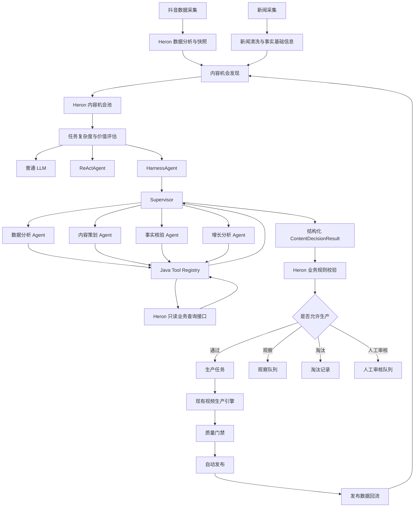

# Heron 智能内容决策引擎
## AgentScope Java 2.0 + HarnessAgent 最终架构设计与分阶段实施计划

**项目名称：** Heron  
**核心技术路线：** AgentScope Java 2.0 + HarnessAgent  
**后端技术栈：** Java / Spring Boot / JDK 21  
**主要目标：** 建设数据驱动、自主调查、多 Agent 协作、自动决策的短视频内容生产引擎。  
**实施原则：** 保留 Heron 现有业务体系，渐进式接入 Agent 能力，不推翻现有架构，不影响现有生产业务。

---

# 一、项目最终定位

Heron 是一个数据驱动的自动化短视频生产平台。

系统以抖音数据看板为主要内容来源，以新闻线为辅助内容来源，通过大模型自主分析数据、发现内容机会、研究选题、验证事实、生成策划方案，并将通过质量门禁的内容自动交给现有视频生产系统。

最终目标是：

**系统自主发现值得制作的内容，自主研究、自主判断、自主策划、自主生产、自主发布，并通过发布数据持续优化内容策略。**

人工主要负责：
- 查看系统生成的内容和分析结果。
- 监督自动化运行情况。
- 处理异常和低置信度任务。
- 调整内容策略。
- 抽查视频质量。
- 必要时手动介入选题、编辑、审片和发布。

人工不应成为默认生产流程中的必经环节。

## 1.1 内容来源优先级

主要内容来源：

1. 数据看板内容线：核心内容来源。
2. 新闻内容线：辅助内容来源，只筛选高传播潜力新闻。

初期可将数据线与新闻线的资源分配参考值设置为 80:20，但必须支持后台配置，不能写死。

### 数据看板内容线

大模型需要分析真实采集的数据，发现：

- 排行榜变化。
- 视频播放量、互动量、点赞量、评论量变化。
- 账号增长和异常表现。
- 热门视频共同特征。
- 行业趋势和周期性变化。
- 内容主题变化。
- 商品、账号、视频之间的关联。
- 值得深入研究的数据规律。
- 有持续传播价值的内容机会。

大模型不仅负责生成文案，更重要的是承担数据研究员和内容策划的角色。

### 新闻内容线

新闻不是越多越好。

系统需要自动进行：
- 新闻采集。
- 内容去重和事件归并。
- 来源可信度评估。
- 事实核验。
- 时效性评估。
- 传播潜力分析。
- 视频化价值评估。

只有达到标准的新闻才进入内容生产流程。

---

# 二、总体架构

采用三层架构。

## 2.1 第一层：Heron 确定性业务系统

由现有 Java 后端负责。

负责：
- 抖音数据采集。
- 数据清洗和指标计算。
- 数据快照。
- 新闻采集。
- 内容机会管理。
- 业务候选池。
- 内容决策记录。
- 生产任务管理。
- Frozen Context。
- Frozen Article。
- 任务状态机。
- 任务恢复和重试。
- 幂等控制。
- 视频生产。
- 质量门禁。
- 自动发布。
- 发布结果回流。

这些能力不应该交给 Agent 自由控制。

## 2.2 第二层：Agent 智能决策系统

采用 AgentScope Java 2.0。

核心采用 HarnessAgent，按任务复杂度组合 ReActAgent 和专业子 Agent。

负责：
- 自主分析目标。
- 动态制定研究计划。
- 自主调用 Java Tools。
- 根据查询结果调整研究方向。
- 多轮自主调查。
- 上下文管理。
- 记忆和知识检索。
- 子 Agent 委派。
- 多 Agent 结果整合。
- 事实验证。
- 内容机会判断。
- 输出结构化内容决策结果。

Agent 只能通过经过授权的 Java Tools 访问 Heron 业务数据。

禁止 Agent 直接连接 MySQL 执行任意 SQL。

## 2.3 第三层：Heron 自动化执行系统

继续使用现有生产系统。

负责：
- 接收已经通过业务校验的内容决策。
- 创建生产任务。
- 固化生产上下文。
- 生成脚本。
- 生成视频场景。
- TTS。
- 素材处理。
- 视频渲染。
- FFmpeg 后处理。
- 质量检查。
- 自动发布。
- 发布效果采集。

Agent 不直接操作视频生产数据库，不直接修改生产任务状态，不直接执行发布。

## 2.4 总体架构图



---

# 三、AgentScope 技术选型

## 3.1 核心选型

| 能力 | 技术选择 | 说明 |
|---|---|---|
| Agent 框架 | AgentScope Java 2.0 | 核心框架 |
| 主 Agent | HarnessAgent | 智能研究和任务执行 |
| 轻量 Agent | ReActAgent | 简单自主调查 |
| 多 Agent | AgentScope 协作机制 | 专业角色协作 |
| 业务工具 | Java Tools | 安全访问 Heron |
| 持久化 | Heron MySQL | 业务任务与结果 |
| 缓存 | Redis | 短期缓存、锁、限流 |
| 数据快照 | Heron 现有机制 | 冻结研究依据 |
| 模型 | 可配置模型供应商 | 不绑定单一厂商 |
| 可观测性 | Agent 执行日志与指标 | 记录每次执行过程 |

正式实施前必须核实当前 AgentScope Java 2.0 的实际版本、API、依赖兼容性和 HarnessAgent 能力。

不得根据旧版本示例或其他语言版本的 API 直接编写 Java 代码。

## 3.2 为什么选择 HarnessAgent

Heron 不是简单的聊天应用，而是需要持续执行复杂研究任务的业务系统。

HarnessAgent 的价值在于：

1. 具备自主推理和工具调用能力。
2. 可以管理较长任务的上下文。
3. 可以组合 Skills。
4. 可以利用工作空间。
5. 可以委派子 Agent。
6. 可以支持计划与执行。
7. 可以使用框架提供的记忆和会话管理能力。

但需要注意：

HarnessAgent 是 Agent 运行时，不是 Heron 的业务任务管理系统。

AgentScope 的 Session、Checkpoint、Memory、Workspace 都不能直接替代 Heron 已有的业务状态、Frozen Context、任务恢复和幂等机制。

---

# 四、Agent 角色设计

采用 Supervisor + 专业 Agent 架构。

第一阶段不要求所有 Agent 同时运行。

Supervisor 根据任务类型、数据情况、成本预算动态决定需要哪些专业 Agent。

## 4.1 Supervisor 主控 Agent

核心职责：

- 接收研究目标。
- 理解任务背景。
- 判断研究复杂度。
- 制定初步调查计划。
- 决定使用哪些工具。
- 决定是否调用专业 Agent。
- 根据工具结果调整计划。
- 判断证据是否充分。
- 决定继续调查或结束。
- 汇总专业 Agent 结果。
- 生成最终结构化决策。

Supervisor 不负责直接修改业务数据。

## 4.2 数据分析 Agent

职责：

- 分析账号数据。
- 分析视频数据。
- 分析排行榜。
- 分析趋势。
- 分析异常增长。
- 分析互动变化。
- 发现数据关联。
- 提出可验证的数据洞察。

输出：

- 数据事实。
- 指标变化。
- 关键证据。
- 潜在内容机会。
- 需要继续调查的问题。

## 4.3 内容策划 Agent

职责：

- 判断内容是否值得制作。
- 判断目标受众。
- 设计内容切入角度。
- 设计视频叙事结构。
- 设计开场钩子。
- 提出标题和表达形式。
- 评估内容是否具有短视频传播价值。

输出：

- 选题标题。
- 核心观点。
- 受众画像。
- 内容角度。
- 视频结构建议。
- 开场创意。
- 预期内容价值。

## 4.4 事实核验 Agent

职责：

- 独立查询原始数据。
- 检查统计口径。
- 检查时间范围。
- 检查数据来源。
- 检查数据是否过期。
- 检查结论是否超出证据。
- 检查内容中是否存在未经证实的推断。

特别要求：

事实核验 Agent 不应只读取其他 Agent 的总结。

关键结论必须能够回到原始数据快照和查询证据进行验证。

## 4.5 增长分析 Agent

职责：

- 分析历史视频发布效果。
- 分析不同主题的表现。
- 分析不同开场方式的表现。
- 分析不同视频时长的表现。
- 分析账号的历史增长情况。
- 为内容策划提供历史数据支持。

该 Agent 可以后置实施。

---

# 五、Agent 自主调查机制

这是整个项目最重要的能力。

不能把 Agent 设计成固定步骤的流水线。

应该采用自主规划、执行、观察和调整的方式。

## 5.1 示例

研究目标：

为什么某个抖音账号最近 7 天增长异常？

Supervisor 首先查询账号数据。

发现：
- 粉丝增长明显。
- 播放量明显增加。
- 但互动增长比例并不一致。

它可以自行判断下一步：

1. 查询最近 7 天发布的视频。
2. 找到贡献最大的视频。
3. 查询视频主题和互动数据。
4. 查询同领域账号是否也出现类似增长。
5. 查询历史同类内容表现。
6. 判断是偶发爆款还是行业趋势。
7. 必要时让数据分析 Agent 和增长分析 Agent 分别调查。
8. 让事实核验 Agent 独立检查关键数据。
9. 汇总调查结果。

如果证据仍然不足，可以继续查询。

如果证据已经足够，则提前结束。

## 5.2 自主调查预算

必须设置硬性预算，避免 Agent 无限循环。

建议初始配置：

| 限制 | 初始值 |
|---|---:|
| Supervisor 最大推理轮数 | 8 |
| 单任务工具调用总次数 | 12 |
| 同时运行的专业 Agent | 3 |
| 单次调查最长时间 | 5 分钟 |
| 普通数据工具超时 | 10 秒 |
| 单任务 Token 预算 | 可配置 |
| 单任务费用上限 | 可配置 |
| Agent 最大委派次数 | 可配置 |

上述为初始参考值，必须可通过配置调整。

当达到预算：
- 停止继续调查。
- 保存已获取证据。
- 输出部分结果。
- 标记是否需要人工复核。
- 不得伪造完整结论。

## 5.3 调查结束条件

满足以下条件之一即可结束：

- 已找到足够证据支持结论。
- 继续调查的边际价值较低。
- 关键数据不可获取。
- 数据存在严重冲突。
- Token 预算耗尽。
- 调查时间超限。
- 达到最大推理轮数。

---

# 六、Java Tools 设计

Agent 不允许直接执行任意 SQL。

所有数据访问必须经过 Java Tools。

## 6.1 数据查询工具

建议提供：

| Tool | 作用 |
|---|---|
| query_account_metrics | 查询账号指标 |
| query_video_metrics | 查询视频指标 |
| query_account_videos | 查询账号视频列表 |
| query_rank_changes | 查询排行榜变化 |
| query_trend_series | 查询趋势序列 |
| query_industry_metrics | 查询行业指标 |
| compare_video_performance | 对比视频表现 |
| analyze_account_growth | 查询账号增长分析 |
| query_historical_content | 查询历史内容 |
| query_published_performance | 查询已发布视频表现 |
| query_news_sources | 查询新闻来源 |
| query_news_event | 查询新闻事件及相关报道 |

实际 Tool 应根据现有 Heron 服务和数据库实体进行映射，不要重复实现已有业务能力。

## 6.2 Tool 设计要求

每个 Tool 必须：

- 有明确名称和描述。
- 有明确输入 Schema。
- 有明确输出 Schema。
- 有参数合法性校验。
- 有时间跨度限制。
- 有结果数量限制。
- 有权限校验。
- 有超时限制。
- 有调用日志。
- 有错误分类。
- 有必要的调用成本记录。

Tool 输出尽量结构化。

不要把大段原始数据直接塞入 Agent 上下文。

例如：

```json
{
  "accountId": "123",
  "period": "7d",
  "metrics": {
    "playCount": 1200000,
    "followerGrowth": 32000,
    "interactionRate": 0.082
  },
  "evidence": [
    {
      "metric": "followerGrowth",
      "value": 32000,
      "comparisonValue": 8000,
      "changeRate": 3.0,
      "snapshotId": "snapshot-001"
    }
  ]
}
```

## 6.3 安全边界

必须遵守：

1. Agent 只拥有业务查询权限。
2. 不允许自由 SQL。
3. 不允许访问任意文件系统路径。
4. 不允许任意执行 Shell 命令。
5. 不允许直接修改候选池状态。
6. 不允许直接创建生产任务。
7. 不允许直接调用抖音发布接口。
8. 不允许越权访问其他账号或租户的数据。
9. 所有外部工具调用必须记录执行结果。
10. 对工具返回值进行长度限制和可信度处理。

如果现有项目存在租户隔离，则必须沿用现有租户上下文和权限体系。

---

# 七、内容决策引擎

这是 Agent 分析结果进入 Heron 业务体系的核心边界。

Agent 不应该只返回一段自然语言。

必须返回结构化决策。

## 7.1 决策类型

```java
public enum ContentDecisionType {

    PRODUCE,

    OBSERVE,

    REJECT,

    NEED_REVIEW
}
```

含义：

- PRODUCE：建议进入生产。
- OBSERVE：继续观察，等待更多数据。
- REJECT：不值得生产。
- NEED_REVIEW：需要人工审核。

最终是否允许生产，仍然由 Heron 业务规则校验。

## 7.2 ContentDecisionResult

建议结构：

```java
public class ContentDecisionResult {

    private String opportunityId;

    private String title;

    private String contentSource;

    private ContentDecisionType decision;

    private String decisionReason;

    private BigDecimal opportunityScore;

    private BigDecimal confidence;

    private List<String> keyInsights;

    private List<String> evidenceIds;

    private List<String> riskWarnings;

    private List<String> suggestedAngles;

    private ContentPlan contentPlan;

    private String modelId;

    private String promptVersion;

    private String agentVersion;
}
```

字段需要结合现有项目命名规范调整。

不得为了照搬示例而重复建设已有 DTO。

## 7.3 内容评分

建议采用确定性评分 + LLM 语义评价的组合方式。

Java 确定性计算：

- 数据增长率。
- 排名变化。
- 互动率。
- 数据新鲜度。
- 历史表现。
- 内容重复程度。
- 来源可靠性。

LLM 评价：

- 内容价值。
- 受众价值。
- 选题新颖性。
- 传播潜力。
- 叙事空间。
- 视频化可行性。

最终评分权重必须可配置，并且保存评分依据。

不要让模型随意编造评分依据。

---

# 八、Frozen Context 与证据管理

Heron 已有 Frozen Context、Frozen Article 等机制。

必须优先复用。

Agent 研究过程应当绑定确定的数据快照。

每个调查任务至少记录：

- 研究目标。
- 数据快照 ID。
- 新闻快照 ID（如果涉及新闻）。
- 研究开始时间。
- 研究结束时间。
- AgentScope 版本。
- Agent 类型。
- 模型供应商。
- 模型名称。
- Prompt 版本。
- Tool 版本。
- Token 使用情况。
- 调查轮数。
- Tool 调用情况。
- 子 Agent 执行情况。
- 最终结论。
- 决策结果。
- 证据列表。

关键结论必须能够追溯到具体证据。

对于数据变化较快的场景，不能只保存查询时间而不保存数据版本或快照标识。

## 8.1 记忆设计

将记忆分为：

1. 会话记忆：当前研究任务内的上下文。
2. 研究记忆：历史研究结论和证据。
3. 策略记忆：经过验证的内容策略。
4. 历史表现：已发布内容的实际表现。

记忆不能直接作为事实来源。

历史记忆中的数据结论必须注明时间和来源，必要时重新查询原始数据。

不能把未经验证的 Agent 推断长期写入可信知识库。

---

# 九、数据库设计

实施前必须先检查现有数据库、实体和任务表。

以下是逻辑设计建议，不代表必须全部新增。

| 表名 | 用途 |
|---|---|
| heron_agent_task | Agent 研究任务 |
| heron_agent_execution | Agent 执行过程 |
| heron_agent_tool_call | 工具调用记录 |
| heron_content_decision | 内容决策记录 |
| heron_agent_evaluation | Agent 评估结果 |
| heron_agent_experiment | A/B 实验配置 |

`heron_content_opportunity` 是否新增，必须根据现有候选池结构决定。

如果现有候选池已经能够承载内容机会，则继续复用。

## 9.1 heron_agent_task

建议字段：

- id
- task_no
- opportunity_id
- task_type
- execution_mode
- status
- research_goal
- snapshot_id
- agent_type
- model_id
- prompt_version
- max_iterations
- max_tool_calls
- token_budget
- token_used
- cost_budget
- cost_used
- started_at
- finished_at
- error_message
- created_at
- updated_at

## 9.2 heron_agent_execution

建议记录：

- task_id
- execution_no
- agent_name
- agent_type
- input_summary
- output_summary
- status
- started_at
- finished_at
- token_usage
- error_message

## 9.3 heron_agent_tool_call

建议记录：

- task_id
- execution_id
- tool_name
- request_summary
- response_summary
- status
- duration_ms
- error_code
- created_at

注意敏感数据脱敏，不能无条件记录所有原始数据。

## 9.4 heron_content_decision

建议记录：

- opportunity_id
- agent_task_id
- decision_type
- score
- confidence
- decision_reason
- evidence_snapshot
- risk_warnings
- prompt_version
- model_id
- created_at

数据库字段类型、索引、唯一约束和关联关系必须依据现有项目规范确定。

---

# 十、任务状态与恢复

Heron 必须继续拥有业务任务状态。

建议逻辑状态：

```text
PENDING
  |
  v
RUNNING
  |
  +----> WAITING_CHILDREN
  |
  +----> COMPLETED
  |
  +----> PARTIAL
  |
  +----> FAILED
  |
  +----> CANCELLED
```

实际状态应与现有任务体系统一，避免重复创建一套相似状态机。

## 10.1 恢复机制

需要区分：

- Agent 内部执行恢复。
- Heron 业务任务恢复。
- 外部工具调用恢复。
- 视频生产恢复。
- 发布任务恢复。

Heron 应当是最终业务状态的唯一权威来源。

恢复时必须：
1. 检查业务任务状态。
2. 检查已完成的 Tool 调用。
3. 检查数据快照是否仍有效。
4. 判断是否可以复用已完成的调查结果。
5. 避免重复创建内容决策。
6. 避免重复创建生产任务。
7. 避免重复发布。

AgentScope Checkpoint 可以辅助恢复 Agent 会话，但不能代替上述业务判断。

---

# 十一、三种运行模式

必须支持三种模式。

## 11.1 MANUAL

人工模式。

- 人工选择选题。
- Agent 提供分析建议。
- 人工确认决策。
- 人工触发生产。

适合初期验证。

## 11.2 SEMI_AUTO

半自动模式。

- 系统自动发现机会。
- Agent 自动研究。
- 系统自动生成内容策划。
- 人工确认选题。
- 后续生产可自动执行。

适合早期上线。

## 11.3 AUTO

全自动模式。

- 自动发现内容机会。
- 自动判断研究等级。
- 自动调查和核验。
- 自动完成内容决策。
- 自动创建生产任务。
- 自动生成视频。
- 自动执行质量门禁。
- 自动发布。
- 自动回收效果数据。

必须设置独立的 AUTO 开关和风险阈值。

高风险、证据不足、来源不可信、质量门禁失败的任务不能自动发布。

---

# 十二、成本控制

Agent 不应成为所有任务的默认执行方式。

采用三级智能分析策略。

| 等级 | 技术方案 | 适用场景 |
|---|---|---|
| L1 | 普通 LLM | 普通数据摘要、简单排行榜分析 |
| L2 | ReActAgent | 异常增长、趋势分析、复杂数据查询 |
| L3 | HarnessAgent + 多 Agent | 高价值选题、复杂研究、重大新闻核验 |

初始机会筛选尽量由 Java 完成。

只有达到相应价值阈值的内容才升级到更高等级。

## 12.1 成本记录

必须统计：

- Input Tokens。
- Output Tokens。
- Cached Tokens（供应商支持时）。
- Model Calls。
- Tool Calls。
- Agent 数量。
- 执行时间。
- 实际费用。
- 单个选题研究成本。
- 单个有效发布内容成本。

预算控制：

- 单任务 Token 上限。
- 单任务金额上限。
- 每日模型费用上限。
- 每日最大研究任务数量。
- 最大 Agent 并发。
- 最大调查轮数。
- 最大工具调用次数。

成本控制不能只靠 Prompt 提醒，必须在 Java 调度和执行层强制实施。

---

# 十三、前端功能设计

优先扩展现有前端页面和组件，不重新设计整个系统。

建议新增或改造：

## 13.1 智能内容决策中心

展示：

- 今日发现的内容机会。
- 待研究任务。
- 正在调查任务。
- 已完成研究任务。
- 推荐生产选题。
- 观察中的选题。
- 已淘汰选题。
- 待人工审核选题。

## 13.2 Agent 研究详情

展示：

- 研究目标。
- 数据快照。
- 研究计划。
- 当前执行步骤。
- Agent 调用记录。
- Tool 调用记录。
- 子 Agent 结果。
- 关键证据。
- 最终研究结论。
- Token 和费用。
- 风险提示。

不要求将所有内部思考链完整展示给用户。

应展示可审计的执行摘要、调用记录、关键证据和决策依据。

## 13.3 内容决策详情

展示：

- 选题名称。
- 来源类型。
- 内容评分。
- 置信度。
- 核心洞察。
- 数据证据。
- 传播潜力。
- 风险。
- 视频策划。
- 最终决策。
- 决策原因。

## 13.4 成本与运行监控

展示：

- 今日模型费用。
- 本月模型费用。
- 各模型调用量。
- 各 Agent 调用量。
- 平均任务耗时。
- 任务失败率。
- 工具调用成功率。
- 单条有效选题成本。

---

# 十四、评估与 A/B 实验

必须通过实际实验判断 HarnessAgent 是否比普通 LLM 和 ReActAgent 更有价值。

不能因为采用了多 Agent，就默认结果更好。

## 14.1 三组对照

A 组：普通 LLM 单次分析。

B 组：ReActAgent 自主调查。

C 组：HarnessAgent + 多 Agent。

实验要求：

- 使用相同选题。
- 使用相同数据快照。
- 尽量使用相同模型。
- 使用相同评价标准。
- 保持相同的数据可访问范围。
- 记录完整 Token 和费用。

建议每组至少 30 个样本作为第一轮初步验证。

## 14.2 评价维度

| 指标 | 评价内容 |
|---|---|
| 事实准确率 | 结论是否符合原始数据 |
| 洞察有效性 | 是否发现有价值的信息 |
| 选题新颖性 | 是否避免重复和同质化 |
| 内容吸引力 | 是否具备传播潜力 |
| 开场创意 | 是否有有效的开场钩子 |
| 可制作性 | 是否能实际制作成视频 |
| 核验通过率 | 是否通过独立事实核验 |
| Token 成本 | 每个任务的实际费用 |
| 执行时间 | 完成研究需要的时间 |

使用人工盲评。

如果 HarnessAgent 没有显著提高质量，或者质量提升远低于成本增加，应调整策略。

## 14.3 最终关注指标

最重要的不是 Agent 数量，而是：

**每消耗 1 元模型费用，能产生多少个经过验证、值得发布、最终表现良好的视频选题。**

---

# 十五、生产安全与非功能性要求

必须满足：

1. 不影响现有生产业务。
2. 不默认启用全自动发布。
3. 不允许 Agent 直接修改业务数据。
4. 不允许 Agent 直接执行任意 SQL。
5. 不允许 Agent 自由调用未注册工具。
6. 所有工具调用均有超时和错误处理。
7. 所有任务都有最大执行预算。
8. 所有任务都可以查询执行记录。
9. 任务支持取消。
10. 任务支持失败重试。
11. 任务支持中断后恢复。
12. 重要操作具备幂等保护。
13. 研究结果绑定数据快照。
14. 关键事实必须有证据。
15. 重要异常进入人工审核。
16. 模型和 Prompt 支持版本管理。
17. 不将敏感数据暴露给不必要的模型调用。
18. 具备 Agent 调用、费用和失败率监控。

---

# 十六、分阶段实施计划

禁止一次性开发全部功能。

每个阶段必须独立验收，上一阶段通过后再进入下一阶段。

## Phase 0：代码基线与架构审查

**目标：** 先确认现有 Heron 到底有哪些能力，避免重复开发。

工作内容：

1. 检查后端仓库。
2. 检查前端仓库。
3. 检查现有数据库表。
4. 检查现有候选池。
5. 检查 Frozen Context。
6. 检查 Frozen Article。
7. 检查任务状态机。
8. 检查任务恢复机制。
9. 检查模型调用封装。
10. 检查现有 Prompt 管理。
11. 检查历史数据分析能力。
12. 检查现有生产流程。
13. 检查现有权限、租户和审计体系。
14. 核实 AgentScope Java 2.0 当前稳定版本及 HarnessAgent 实际 API。

输出：

- `docs/architecture/heron-agent-architecture-review.md`
- `docs/architecture/heron-agent-implementation-plan.md`
- `docs/architecture/heron-agentscope-compatibility.md`

验收标准：

- 明确哪些能力可以复用。
- 明确哪些能力需要新增。
- 明确哪些能力不能迁移。
- 明确 AgentScope 依赖和 JDK 21 兼容性。
- 明确现有业务边界。
- 明确数据库改造范围。
- 明确生产环境风险。

**本阶段禁止修改业务代码、数据库结构和生产部署。**

## Phase 1：AgentScope HarnessAgent 技术 PoC

**目标：** 验证 HarnessAgent 是否适合当前 Heron 后端。

工作内容：

1. 建立独立 PoC 模块或隔离分支。
2. 引入 AgentScope Java 2.0。
3. 验证 HarnessAgent 基础运行。
4. 验证模型供应商接入。
5. 验证 ReAct 工具调用。
6. 验证 Java Tool 注册。
7. 验证多轮调查。
8. 验证上下文管理。
9. 验证 Skills。
10. 验证子 Agent 委派。
11. 验证 Checkpoint 和会话恢复能力。
12. 验证 Token 使用量统计。
13. 验证超时和取消机制。

注意：

不是要求本阶段把所有功能接入 Heron。

先验证实际 API、依赖、能力和运行稳定性。

PoC 示例：

输入研究目标：

“分析某个账号最近 7 天增长情况，找出增长最快的视频，并解释原因。”

HarnessAgent 通过 Java Mock Tools 自主查询数据，最终输出结构化报告。

验收标准：

- 能够自主调用多个工具。
- 能够根据工具返回结果改变下一步调查方向。
- 能够完成多轮研究。
- 能够调用专业子 Agent。
- 能够输出结构化结果。
- 能够统计 Token 和费用。
- 能够限制工具调用次数。
- 不存在无限循环。
- 验证会话能力，但不把 Agent 会话恢复等同于业务任务恢复。

## Phase 2：Heron Agent 基础设施

**目标：** 建立正式接入业务系统的基础设施。

工作内容：

1. AgentScope 配置管理。
2. 模型供应商配置。
3. 模型调用封装。
4. HarnessAgent 创建与管理。
5. ReActAgent 轻量执行器。
6. Java Tool Registry。
7. Tool 参数校验。
8. Tool 权限控制。
9. Token 预算控制。
10. 费用预算控制。
11. Agent 执行日志。
12. Tool 调用日志。
13. 执行超时和取消。
14. Agent 任务持久化。
15. 与现有 Frozen Context 集成。
16. 与现有任务体系集成。

数据库改造必须先检查现有表，尽量复用。

验收标准：

- 能够创建 Agent 研究任务。
- 能够查询完整执行记录。
- 能够限制模型费用。
- 能够限制工具调用。
- 能够安全访问现有业务数据。
- Agent 异常不会影响现有生产任务。

## Phase 3：自主数据调查能力

**目标：** 让 Agent 真正具备自主研究数据的能力。

工作内容：

1. 接入账号数据 Tools。
2. 接入视频数据 Tools。
3. 接入排行榜 Tools。
4. 接入趋势数据 Tools。
5. 接入行业数据 Tools。
6. 接入历史内容 Tools。
7. 接入发布效果 Tools。
8. 实现自主调查策略。
9. 实现调查结束判断。
10. 实现证据收集。
11. 实现结构化研究报告。

优先实现单个 HarnessAgent 自主调查，不急于增加多个专业 Agent。

验收标准：

- 能够从一个研究目标自主发起调查。
- 能够根据中间数据动态选择查询工具。
- 能够发现数据异常。
- 能够形成证据链。
- 能够在证据不足时停止并说明原因。
- 能够将结果绑定数据快照。
- 能够在预算限制内完成研究。

## Phase 4：多 Agent 协作

**目标：** 提升复杂研究的深度和可信度。

实施顺序：

第一批：

- Supervisor。
- 数据分析 Agent。
- 内容策划 Agent。
- 事实核验 Agent。

第二批：

- 增长分析 Agent。
- 新闻研究 Agent（如现有新闻业务确实需要）。

工作内容：

1. 配置专业 Agent。
2. 定义各 Agent 职责。
3. 定义输入输出 Schema。
4. 实现子 Agent 委派。
5. 实现并行研究。
6. 实现结果汇总。
7. 实现冲突识别。
8. 实现独立事实核验。
9. 实现最大并发和费用限制。

不要每个任务都强制调用全部 Agent。

Supervisor 应根据任务价值和复杂度选择必要角色。

验收标准：

- 多 Agent 能够独立完成专业任务。
- 不同 Agent 的职责没有严重重叠。
- 核验 Agent 能够独立访问原始证据。
- 能够识别不同 Agent 结论冲突。
- 多 Agent 结果能够统一汇总。
- 多 Agent 的质量提升通过实验验证。

## Phase 5：内容决策中心接入

**目标：** 让 Agent 研究结果正式进入 Heron 内容业务体系。

工作内容：

1. 接入现有内容机会池。
2. 接入现有候选池。
3. 实现三级智能分析策略。
4. 实现内容机会评分。
5. 实现结构化决策结果。
6. 实现 PRODUCE、OBSERVE、REJECT、NEED_REVIEW。
7. 实现证据详情。
8. 实现决策历史。
9. 实现重复选题检测。
10. 实现决策理由记录。
11. 实现人工审核入口。
12. 实现决策中心前端页面。

验收标准：

- 数据线能够自动发现内容机会。
- 新闻线能够自动筛选高价值新闻。
- 机会可以进入不同决策状态。
- 每个决策都有评分依据。
- 关键结论能够追溯数据证据。
- 不重复创建相同选题。
- 人工可以修改或否决 Agent 建议。
- 不破坏现有候选池和编辑流程。

## Phase 6：自动生产接入

**目标：** 让经过验证的内容决策能够自动进入现有视频生产流程。

工作内容：

1. 将 PRODUCE 决策映射到现有生产任务。
2. 自动生成内容策划。
3. 自动生成脚本。
4. 复用现有 Scene Contract。
5. 复用现有素材处理。
6. 复用现有 TTS。
7. 复用现有视频渲染。
8. 复用现有质量门禁。
9. 实现生产失败恢复。
10. 实现重复生产幂等保护。

重点：

不要重新开发视频生产引擎。

不要因为接入 AgentScope 就替换现有 HyperFrames、GSAP、FFmpeg 等生产能力。

验收标准：

- Agent 能够输出可生产的内容策划。
- 生产任务创建具备幂等保护。
- Frozen Context 能够完整保存。
- 视频生产异常不会导致研究任务状态混乱。
- 失败任务可以恢复。
- 生产结果通过现有质量门禁。

## Phase 7：自动发布与效果反馈

**目标：** 建立从数据发现到发布效果回流的闭环。

工作内容：

1. 接入现有发布能力。
2. 建立自动发布开关。
3. 建立发布风险控制。
4. 建立发布前质量门禁。
5. 建立发布任务幂等机制。
6. 接入发布结果。
7. 接入播放量和互动数据。
8. 分析不同内容类型表现。
9. 分析选题与实际效果的关系。
10. 将历史表现作为后续 Agent 研究依据。

验收标准：

- 自动发布只能执行经过业务规则校验的任务。
- 失败和异常可以追踪。
- 不会因恢复任务而重复发布。
- 发布数据能够回流。
- 内容策略能够使用真实历史数据优化。

## Phase 8：人工监督工作台与运营优化

**目标：** 将人工操作变成监督、策略管理和异常处理。

工作内容：

1. 智能内容决策中心完善。
2. Agent 执行监控。
3. 异常任务处理。
4. 人工复核。
5. 内容策略配置。
6. Agent 运行模式配置。
7. 模型成本监控。
8. 多 Agent 质量评估。
9. A/B 实验。
10. 自动化运行效果分析。

验收标准：

- 能够查看自动化生产全链路。
- 能够定位异常原因。
- 能够手动介入任务。
- 能够调整内容策略。
- 能够控制模型费用。
- 能够对比不同 Agent 策略的实际收益。

---

# 十七、Codex / Claude Code 执行规则

以下内容是本项目的强制执行规范。

## 17.1 第一轮只执行 Phase 0

你现在负责 Heron 项目的 AgentScope 智能内容决策引擎建设。

必须先阅读：

- 后端仓库全部相关业务代码。
- 前端仓库相关页面和 API。
- 数据库实体和迁移文件。
- 现有内容候选池。
- Frozen Context。
- Frozen Article。
- 生产任务体系。
- 任务恢复机制。
- 模型调用和 Prompt 管理。
- 现有发布和效果回流能力。

如果前后端仓库在本地没有同时存在，明确说明缺失的仓库和无法检查的范围，不允许假设已经检查。

随后研究 AgentScope Java 2.0 官方文档、当前稳定版本和实际 API。

重点研究：

- HarnessAgent。
- ReActAgent。
- Tool Calling。
- Skills。
- Workspace。
- Memory。
- Context Management。
- SubAgent。
- Checkpoint。
- Session。
- Model Integration。
- Spring Boot 集成。

不得把其他语言版本的 API 当作 Java API 使用。

## 17.2 Phase 0 必须输出

创建：

`docs/architecture/heron-agent-architecture-review.md`

内容：

- 当前系统架构。
- 现有能力清单。
- 现有业务流程。
- 可复用模块。
- 需要扩展模块。
- 需要新增模块。
- 数据库现状。
- 当前任务状态与恢复机制。
- AgentScope 集成风险。
- 生产环境风险。
- 不应该改造的部分。

创建：

`docs/architecture/heron-agent-implementation-plan.md`

内容：

- 最终推荐架构。
- 模块划分。
- 类和接口设计建议。
- Tool 设计。
- Agent 角色。
- 数据库变更建议。
- API 设计建议。
- 前端页面规划。
- 每个 Phase 的具体开发任务。
- 每个 Phase 的测试要求。
- 每个 Phase 的验收标准。
- 工作量和风险评估。

创建：

`docs/architecture/heron-agentscope-compatibility.md`

内容：

- 当前 AgentScope Java 2.0 稳定版本。
- JDK 21 兼容性。
- Spring Boot 兼容性。
- Maven 依赖。
- HarnessAgent 实际 API。
- ReActAgent 实际 API。
- 子 Agent 能力。
- Skills 能力。
- Workspace 能力。
- Memory 能力。
- Checkpoint 能力。
- 已验证能力。
- 未验证能力。
- 不适合当前项目的能力。

所有技术结论必须有官方文档或实际 PoC 依据。

## 17.3 严格禁止

Phase 0 禁止：

- 修改业务代码。
- 修改数据库结构。
- 修改现有配置。
- 修改生产部署。
- 重启任何服务。
- 删除现有模块。
- 重构现有业务流程。
- 替换现有视频生产系统。
- 替换现有任务状态机。
- 擅自引入大量新依赖。

可以创建上述三个架构文档，但不得实施业务代码改造。

## 17.4 后续开发规则

Phase 0 完成后，先向用户提交审查报告和实施计划。

等待用户确认后才能进入 Phase 1。

之后每个 Phase 都必须遵循：

1. 先分析。
2. 输出本阶段实施计划。
3. 确认涉及的文件、类、表和接口。
4. 评估对现有功能的影响。
5. 实施代码。
6. 编写或补充测试。
7. 执行测试。
8. 执行代码 Review。
9. 修复发现的问题。
10. 输出实施报告。
11. 等待确认进入下一阶段。

不要一次性实施多个 Phase。

每个阶段必须保持现有功能兼容。

发现现有代码存在确定性 Bug，可以单独报告；未经授权不得顺手扩大改造范围。

## 17.5 代码质量要求

- 遵循现有项目架构。
- 遵循现有命名规范。
- 优先复用现有服务。
- 不重复实现已有能力。
- 不为了 Agent 抽象而抽象。
- 不创建没有明确用途的通用框架。
- 不随意修改公共接口。
- 不破坏事务边界。
- 不破坏租户上下文。
- 不破坏异步任务上下文。
- 不允许 Agent 绕过业务权限。
- 不允许 Agent 自由 SQL。
- 不允许 Agent 自由执行系统命令。
- 所有外部操作都必须具备必要的幂等和审计机制。
- 所有新增功能必须有测试。
- 优先最小改动，避免无关重构。

---

# 十八、最终交付目标

最终 Heron 应具备以下能力：

1. 自动采集和分析抖音数据。
2. 自动发现有价值的内容机会。
3. 使用普通 LLM、ReActAgent、HarnessAgent 按任务复杂度分层执行。
4. HarnessAgent 能够自主规划研究步骤。
5. 能够动态调用 Heron Java Tools。
6. 能够根据数据结果调整研究方向。
7. 能够委派多个专业 Agent。
8. 能够独立核验关键事实。
9. 能够形成可追溯的证据链。
10. 能够自动判断内容是否值得生产。
11. 能够自动进入现有视频生产系统。
12. 能够执行质量门禁。
13. 能够自动发布。
14. 能够回收实际发布效果。
15. 能够持续优化选题和内容策略。
16. 人工主要负责监督、审核异常和调整策略。

最终架构原则：

**Agent 负责思考，Heron 负责业务；Agent 负责研究，Heron 负责执行；Agent 可以自主规划，但不能突破业务边界。**

项目真正的成功标准不是部署了多少个 Agent，而是能否稳定地产出值得发布的视频，并通过真实发布效果证明这套系统比传统单次 LLM 调用更有价值。